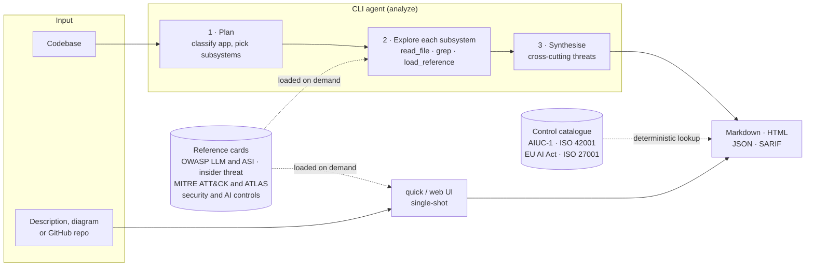

<p align="center">
  
</p>

<p align="center">
  <a href="https://github.com/mrwadams/stride-gpt/actions/workflows/ci.yml"></a>
  <a href="https://pypi.org/project/stride-gpt/"></a>
  
  <a href="LICENSE-MIT"></a>
</p>

> **About this repository.** Nexus-stride-gpt is where we collaborate on enhancements to [mrwadams/stride-gpt](https://github.com/mrwadams/stride-gpt). It holds STRIDE GPT with upstream's full git history, kept in sync with upstream's `master` (the [workflow guide](docs/nexus-workflow.md) explains how), plus the enhancement commits listed under *Unreleased* in the [changelog](CHANGELOG.md). STRIDE GPT is &copy; Matt Adams and released under the MIT License; see [License](#license).

AI-powered STRIDE threat modelling. Point it at a codebase or describe an application &mdash; get a threat model with verified code evidence, OWASP/MITRE annotations, 69 security controls, and compliance mapping to **AIUC-1**, **ISO 42001**, **ISO 27001** and the **EU AI Act**.

```bash
pip install stride-gpt
export ANTHROPIC_API_KEY=your-key        # or OPENAI_API_KEY, GOOGLE_API_KEY, ...
stride-gpt analyze ./my-app -o report.md # agentic codebase analysis
stride-gpt quick -i description.txt      # single-shot from text
```

## Contents

- [How it works](#how-it-works)
- [Autonomy levels](#autonomy-levels)
- [Features](#features)
- [Installation](#installation)
- [Usage](#usage)
- [Sample output](#sample-output)
- [Security and privacy](#security-and-privacy)
- [Documentation](#documentation)
- [Contributing](#contributing)
- [License](#license)

## How it works



1. **Plan.** Architect model classifies the codebase and proposes 3&ndash;7 subsystems.
2. **Explore.** Per-subsystem agent reads files, greps, and loads only the reference cards it needs (OWASP, MITRE, controls). Each threat cites a code snippet verified against the file on disk.
3. **Synthesise.** One call finds cross-cutting threats that span subsystems, with evidence verification.
4. **Report.** Control IDs the model chose are mapped to framework requirements by catalogue lookup, never by generation.

[Architecture deep dive &rarr;](docs/architecture.md)

## Autonomy levels

STRIDE-GPT classifies agentic systems into six autonomy levels, adapted from the CSA Agentic AI Autonomy Levels framework. Higher autonomy demands stronger controls.

| Level | Archetype | Human role | Risk |
|-------|-----------|------------|------|
| **L0** | No Autonomy | AI is a deterministic tool; no planning or chaining | None |
| **L1** | Human-as-Operator | Approves every action before it runs | Low |
| **L2** | Human-as-Collaborator | Agent acts within scoped boundaries; some actions auto-approved | Medium |
| **L3** | Human-as-Supervisor | Agent runs autonomously per task; human reviews outputs | High |
| **L4** | Human-as-Auditor | Continuous execution with persistent access; periodic log review | Critical |
| **L5** | Fully Autonomous | Self-directed agent; sets own goals, acquires resources, no human in the loop | Extreme |

The [agentic AI controls](docs/agentic-ai-controls.md) baseline scales 14 controls (AGT-01 to AGT-14) by level. The [AI Insider Threat](stride_gpt/core/prompts/threat_model/insider_threat.md) lens treats agents L3+ as potentially untrusted insiders.

## Features

**Analysis** &mdash; Agentic codebase analysis with resumable runs, per-phase token budgets and run manifests. Verified evidence: each threat quotes code matched against the file on disk. Single-shot mode from text descriptions. AI/agentic pattern detection for RAG, multi-agent, code execution, tool/MCP ecosystems, persistent memory.

**Controls & compliance** &mdash; 69 controls in eight domains with deterministic framework mapping to AIUC-1, ISO 42001, EU AI Act, ISO 27001. Exports for GRC as CSV, JSON, SARIF. Browse with `stride-gpt controls`.

**Outputs** &mdash; Markdown, JSON, SARIF, self-contained HTML. MITRE ATT&CK/ATLAS IDs (catalogue-constrained). Data flow diagrams (Mermaid). SARIF imports into GitHub, GitLab, Azure DevOps, IDEs.

**Models** &mdash; OpenAI, Anthropic, Google, Mistral, Groq, DeepSeek, OpenRouter, LM Studio. Reasoning-model support. Two-tier routing: strong architect for planning, fast worker for exploration.

**Web UI** &mdash; Streamlit app with attack trees, mitigations, DREAD scoring, Gherkin test cases, draw.io editor, compliance tab.

### Frameworks and standards

| Framework | Usage | Source |
|-----------|-------|--------|
| STRIDE | Threat categories | Built in |
| OWASP Top 10 for LLM Applications (2025) | `OWASP_LLM` per threat | `genai` card |
| OWASP Top 10 for Agentic Applications (2026) | `OWASP_ASI` per threat | `agentic` card |
| AI Insider Threat | `INSIDER_CATEGORY` + autonomy level (L0&ndash;L5) | `insider_threat` card |
| MITRE ATT&CK Enterprise (v17.1) / ATLAS (2026.05) | Technique IDs, catalogue-constrained | `mitre_*` cards |
| Control catalogue (69 controls) | `CONTROLS` IDs per threat | `security_controls`, `ai_controls` cards |
| AIUC-1, ISO 42001, EU AI Act, ISO 27001 | Deterministic lookup from controls | Catalogue |

## Installation

### pip (CLI)

```bash
pip install stride-gpt
```

### From source (CLI + web UI)

```bash
git clone https://github.com/mrwadams/stride-gpt.git && cd stride-gpt
uv sync                  # or: pip install -e .
cp .env.example .env     # add your API keys
```

### Docker (web UI)

```bash
docker pull mrwadams/stridegpt:latest
docker compose up        # hardened: cap_drop ALL, no-new-privileges, read-only rootfs, resource limits
```

## Usage

### CLI

```bash
# Agentic codebase analysis
stride-gpt analyze .
stride-gpt analyze ./my-app --worker-model anthropic/claude-sonnet-5 -y

# Output formats
stride-gpt analyze . -o report.json -f json
stride-gpt analyze . -o report.sarif -f sarif
stride-gpt analyze . -o report.html -f html

# Single-shot from text
stride-gpt quick -i app-description.txt
echo "A web API that processes payments..." | stride-gpt quick

# Interactive REPL
stride-gpt

# Browse controls and export compliance mapping
stride-gpt controls
stride-gpt controls --report saved-report.json -o mapping.csv
```

> **Cost note:** Agentic analysis makes many LLM calls. Set spending limits with your provider first. Use `--max-llm-calls` to cap per-subsystem calls (default 25).

<details>
<summary>All CLI flags</summary>

| Flag | Description |
|------|-------------|
| `--worker-model` | Default-tier model (e.g. `anthropic/claude-sonnet-5`) |
| `--architect-model` | Stronger model for planning/synthesis |
| `--no-architect` | Skip the architect tier |
| `--app-type` | Override detection: `auto`, `web`, `genai`, `agentic` |
| `--max-llm-calls` | Cap LLM calls per subsystem (default 25, 0 = unlimited) |
| `--max-tool-calls` | Cap code exploration calls (0 = unlimited) |
| `-o`, `--output` | Save report to file |
| `-f`, `--format` | `markdown` (default), `json`, `sarif`, `html` |
| `-i`, `--input` | Read description from file (`quick` only) |
| `-y`, `--yes` | Auto-approve the analysis plan |

Each tier also accepts `--worker-api-key` / `--worker-api-base` / `--worker-max-tokens` (and `--architect-*` equivalents). Run `stride-gpt analyze --help` for the complete list.

</details>

<details>
<summary>REPL commands and shortcuts</summary>

| Command | What it does |
|---------|--------------|
| `/analyze [path]` | Analyze a codebase |
| `/quick` | Quick threat model from text |
| `/reports` | List previous reports (`/reports <n>` views one) |
| `/config` | View or change settings |
| `/help` | Show all commands and flags |
| `/quit` | Exit |

| Key | Action |
|-----|--------|
| `Tab` | Complete commands and file paths |
| `Up/Down` | Scroll history |
| `Right/End` | Accept suggestion |
| `Ctrl+L` | Clear screen |
| `Ctrl+C/D` | Exit |

</details>

<details>
<summary>Structured intermediates</summary>

When `-o <path>` is used, three JSON siblings are written alongside the report:

| File | Contents |
|------|----------|
| `<stem>.plan.json` | Analysis plan: subsystems, focus areas, detected app type |
| `<stem>.findings.json` | Per-subsystem findings, cross-cutting threats, DFD |
| `<stem>.run.json` | Run manifest: models, timing, token usage, references loaded |

A subsystem's `outcome` is `completed`, `budget_exhausted`, `parse_failed`, `error` or `skipped`. File paths in manifests are redacted for safe sharing.

</details>

### Web UI

```bash
streamlit run apps/web/main.py
```

### Docker

```bash
docker run -p 8501:8501 --env-file .env mrwadams/stridegpt
```

Before exposing the UI, put it behind TLS and an identity-aware proxy. See [Deployment hardening](docs/deployment-hardening.md).

## Sample output

<details>
<summary>Sample markdown threat model (click to expand)</summary>

````markdown
# STRIDE Threat Model: acme-payments-api

> Generated by STRIDE-GPT on 2026-07-16T09:42:00Z

## Authentication & Authorization

### Threats

| Threat Type | Scenario | Potential Impact | MITRE ATT&CK | Controls | Evidence |
|-------------|----------|------------------|--------------|----------|----------|
| Spoofing | An attacker forges a JWT using a weak or leaked signing secret to impersonate another customer. | Full account takeover and unauthorized access to stored payment methods. | T1550.001 | IAM-05, DAT-06 | app/auth/jwt.py:14-19 |
| Elevation of Privilege | A standard user calls an admin-only refund endpoint that only checks authentication, not role. | Unauthorized refunds and financial loss. | T1068 | IAM-07 | app/auth/dependencies.py:31-38 |

## Cross-Cutting Threats

| Threat Type | Scenario | Potential Impact | Controls | Affected Subsystems |
|-------------|----------|------------------|----------|---------------------|
| Denial of Service | No rate limiting lets an attacker exhaust the processor quota and DB connections. | Legitimate payments fail. | APP-08, NET-06 | Auth, Payments |

## Controls & Compliance Mapping

| Control | Name | Domain | Threats |
|---------|------|--------|---------|
| IAM-05 | Secure JWT issuance and validation | Identity & Access Management | 1 |
| IAM-07 | Deny-by-default, object-level authorisation | Identity & Access Management | 1 |

### ISO/IEC 27001

| Reference | Requirement | Controls |
|-----------|-------------|----------|
| A.5.15 | Access control | IAM-07 |
| A.8.5 | Secure authentication | IAM-05 |
````

</details>

## Security and privacy

- **Your code goes to the LLM provider you choose.** For sensitive systems, use a local model or a provider with suitable data-handling terms.
- **The agent reads the codebase you point it at.** File tools are sandboxed to the target directory and refuse VCS metadata (`.git`, `.hg`, `.svn`).
- **API keys are credentials.** Keep them in env vars or `~/.stride-gpt/.env`, never in version control.
- **Threat models are sensitive.** A report is a map of your weaknesses: store and share it like one.
- **Team deployments need hardening.** See [Deployment hardening](docs/deployment-hardening.md).

Dependencies are pinned in `uv.lock`, scanned with Bandit, CodeQL, pip-audit, Gitleaks and Trivy. [SECURITY.md](SECURITY.md) has the full policy. Report vulnerabilities via [private advisory](https://github.com/mrwadams/stride-gpt/security/advisories/new).

## Repository layout

```
stride-gpt/
├── stride_gpt/              # shared library + CLI
│   ├── agent/               # agentic engine: planner, loop, tools, evidence
│   └── core/                # LLM abstraction, prompts, schemas
│       ├── controls/        # control catalogue + framework mapping
│       └── prompts/threat_model/  # reference cards (OWASP, MITRE, controls)
├── apps/web/                # Streamlit web UI
├── docs/                    # guides and generated references
├── tests/                   # pytest suite (~1.5s, zero real LLM calls)
└── pyproject.toml           # web UI deps in the `web` dependency group
```

## Documentation

| Guide | Covers |
|-------|--------|
| [Architecture](docs/architecture.md) | Components, agent phases, data flows, trust boundaries |
| [Controls and compliance](docs/controls-and-compliance.md) | How threats map to controls and frameworks |
| [Control catalogue](docs/controls-catalog.md) | All 69 controls with guidance and mappings |
| [Framework crosswalks](docs/framework-crosswalks.md) | Coverage per framework |
| [Agentic AI controls](docs/agentic-ai-controls.md) | Control baseline scaled by autonomy level (L0&ndash;L5) |
| [Deployment hardening](docs/deployment-hardening.md) | Identity, encryption, network, logging |
| [Operationalization](docs/operationalization-guide.md) | Custom controls, CI/CD patterns, enterprise deployment |

## Talk at Open Security Summit

[](https://youtu.be/_eOcezCeM1M?si=88bjQ2M-_sCyIioi)

## Contributing

Pull requests welcome. See [CONTRIBUTING.md](CONTRIBUTING.md) for setup and conventions.

## License

STRIDE GPT is released under the [MIT License](LICENSE-MIT), Copyright (c) 2024 Matt Adams. This repository's top-level [LICENSE](LICENSE) is the Apache License 2.0; see [NOTICE](NOTICE).
