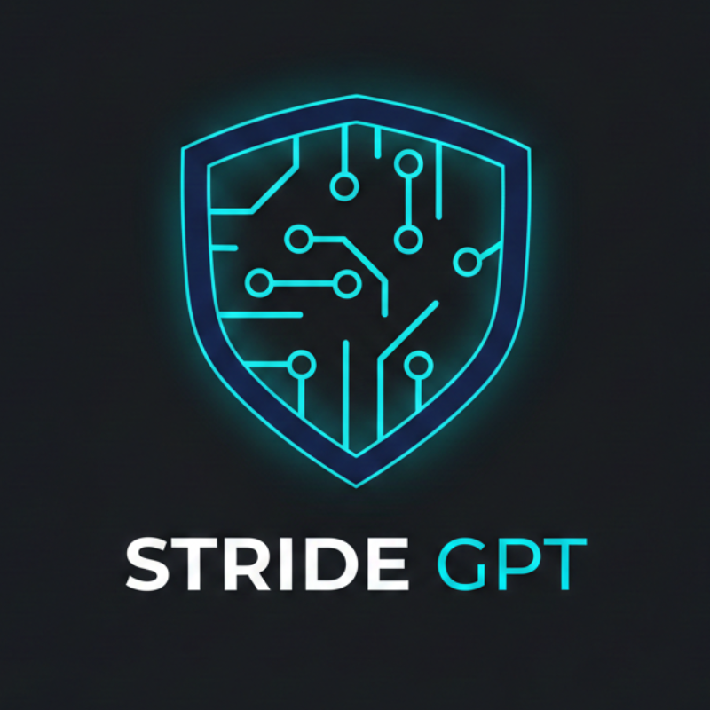
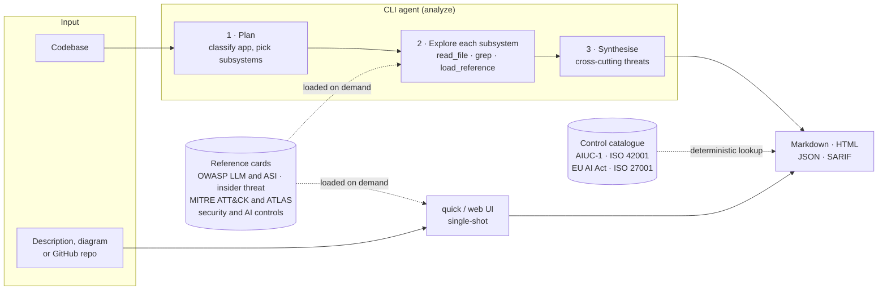
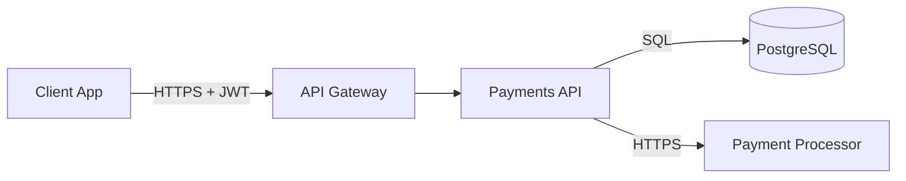

<p align="center">
  
</p>

<p align="center">
  <a href="https://github.com/mrwadams/stride-gpt/actions/workflows/ci.yml"></a>
  <a href="https://pypi.org/project/stride-gpt/"></a>
  
  <a href="LICENSE"></a>
</p>

STRIDE GPT is an AI-powered threat modelling tool. Point it at a codebase or describe an application, and it produces a STRIDE threat model. Threats are grounded in code evidence it has verified, annotated with OWASP and MITRE ATT&CK/ATLAS identifiers, tagged with the security controls that would mitigate them, and mapped to **AIUC-1**, **ISO/IEC 42001**, **ISO/IEC 27001** and the **EU AI Act**.

It ships as two products on one shared library:

- **CLI** (`pip install stride-gpt`): an agent that plans an analysis, explores a real codebase with sandboxed file tools, and reports per-subsystem threats with verified evidence. It also does single-shot threat models from a written description.
- **Streamlit web UI**: a hosted, single-shot threat modeller with attack trees, data flow diagrams, mitigations, DREAD scoring, Gherkin test cases and a compliance view.

## What's new

- **Security control catalogue and compliance mapping.** 69 controls across identity and access (X.509, JWT, OAuth 2.x), data protection (CMEK, TLS, mTLS), network (MACsec, IPsec), logging and monitoring, OWASP application security, AI security, agentic AI and AI governance. Each is mapped to AIUC-1, ISO/IEC 42001, the EU AI Act and ISO/IEC 27001. The model picks control IDs, and STRIDE-GPT looks up the framework references, so a report never cites a clause the model invented. [Read more](docs/controls-and-compliance.md).
- **`stride-gpt controls`** to browse the catalogue, view framework crosswalks, and export a report's mapping as CSV for GRC tools.
- **A Compliance tab in the web UI**, plus the Insider Category, MITRE ATT&CK and Controls columns in its threat table.

Full release history: [CHANGELOG.md](CHANGELOG.md).

## Contents

- [Quick start](#quick-start)
- [How it works](#how-it-works)
- [Features](#features)
- [Frameworks and standards](#frameworks-and-standards)
- [Installation](#installation)
- [Repository layout](#repository-layout)
- [Usage](#usage)
- [Sample output](#sample-output)
- [Security and privacy](#security-and-privacy)
- [Documentation](#documentation)
- [Enterprise deployment](#enterprise-deployment)
- [Talk at Open Security Summit](#talk-at-open-security-summit)
- [Support the project](#support-the-project)
- [Contributing](#contributing)
- [License](#license)

## Quick start

```bash
pip install stride-gpt
export ANTHROPIC_API_KEY=your-key   # or OPENAI_API_KEY, GOOGLE_API_KEY, ... (or put it in ~/.stride-gpt/.env)
stride-gpt                          # first run: the setup wizard picks a provider and model; /quit when done
```

Then threat-model a written description, or a codebase:

```bash
stride-gpt quick -i app-description.txt -o threat-model.md
stride-gpt analyze ./my-app -o report.md
```

Every run is also saved as JSON and a self-contained HTML page under `~/.stride-gpt/reports/`. Agentic analysis makes many model calls, so set a spending limit with your provider first (see the [note on cost](#cli)).

## How it works



1. **Plan.** The architect model scans the codebase, classifies it (web, GenAI or agentic) and proposes 3–7 subsystems for you to approve.
2. **Explore.** For each subsystem, a tool-using agent reads files and greps, then loads only the reference cards it needs: OWASP LLM and Agentic Top 10, AI insider threat, MITRE ATT&CK and ATLAS, and the security and AI control catalogues. Each threat cites a code snippet that is verified against the file on disk.
3. **Synthesise.** One call finds threats that only exist between subsystems, and must cite evidence to count.
4. **Report.** Threats render as Markdown, HTML, JSON or SARIF. Control IDs the model chose are mapped to framework requirements by lookup in the packaged catalogue, never by generation.

[Architecture](docs/architecture.md) covers the data flows, trust boundaries and extension points in depth.

## Features

**Analysis**
- **Agentic codebase analysis**: the agent plans, explores and synthesises across subsystems, with resumable runs, per-phase token accounting and a run manifest for audit.
- **Verified evidence**: each threat cites the code it came from, the snippet is matched against the file, and the line range flows into SARIF locations.
- **Single-shot mode**: `stride-gpt quick` works from a written description. The web UI also accepts an architecture diagram, a draw.io diagram or a GitHub repository (GitHub Enterprise supported).
- **AI and agentic systems**: OWASP Top 10 for LLM Applications and for Agentic Applications, plus an AI Insider Threat lens that treats a high-autonomy agent as a potentially untrusted insider.
- **Architectural pattern detection** for RAG, multi-agent systems, code execution, tool/MCP ecosystems and persistent memory (inspired by [CSA MAESTRO](https://cloudsecurityalliance.org/blog/2025/02/06/agentic-ai-threat-modeling-framework-maestro)).

**Controls and compliance**
- **Control catalogue**: 69 controls in eight domains, each with implementation guidance and sources. See the [catalogue](docs/controls-catalog.md).
- **Deterministic framework mapping** to AIUC-1, ISO/IEC 42001, the EU AI Act and ISO/IEC 27001, with [crosswalks](docs/framework-crosswalks.md) that show coverage and gaps per framework.
- **Exports for GRC**: a compliance section in Markdown and HTML reports, a `compliance` block in JSON, `controls` and `frameworks` properties on SARIF results, and CSV from `stride-gpt controls --report` or the web UI.

**Outputs and integration**
- **Markdown, JSON, SARIF and self-contained HTML**. SARIF imports into GitHub, GitLab, Azure DevOps and IDEs.
- **MITRE ATT&CK and ATLAS IDs**, constrained to catalogued techniques so the model cannot invent one.
- **Data flow diagrams** (Mermaid), generated or parsed from an image, which you can confirm and feed back as the authoritative system model.
- **Web UI extras**: attack trees, mitigations, DREAD risk scoring, Gherkin test cases and an embedded [diagrams.net](https://www.diagrams.net/) editor (self-hostable via `STRIDE_GPT_DRAWIO_URL`).

**Models**
- **Many LLM providers through LiteLLM**: OpenAI, Anthropic, Google, Mistral, Groq, DeepSeek and OpenRouter (CLI only), plus local models via LM Studio.
- **Reasoning-model support** (OpenAI GPT-5.x, Anthropic Claude with extended thinking, Gemini 3, Magistral), and two-tier routing: a strong *architect* model for planning and synthesis, a fast *worker* for exploration.

## Frameworks and standards

| Framework | How STRIDE-GPT uses it | Where it comes from |
|-----------|------------------------|---------------------|
| STRIDE | Threat categories for every threat | Built in |
| OWASP Top 10 for LLM Applications (2025) | `OWASP_LLM` code per threat | `genai` card |
| OWASP Top 10 for Agentic Applications (2026) | `OWASP_ASI` code per threat | `agentic` card |
| AI Insider Threat | `INSIDER_CATEGORY` and autonomy level (L1–L4) | `insider_threat` card |
| MITRE ATT&CK Enterprise (v17.1) and ATLAS (2026.05) | Technique IDs per threat, catalogue-constrained | `mitre_enterprise`, `mitre_atlas` cards |
| STRIDE-GPT control catalogue | `CONTROLS` IDs per threat | `security_controls`, `ai_controls` cards |
| AIUC-1 | Requirements the recommended controls address | Catalogue lookup |
| ISO/IEC 42001:2023 | Annex A controls and clauses | Catalogue lookup |
| EU AI Act (Reg. (EU) 2024/1689, as amended by 2026/1744) | Articles, e.g. 12, 14, 15(5), 50 | Catalogue lookup |
| ISO/IEC 27001:2022 | Annex A controls | Catalogue lookup |
| OWASP Top 10:2025 and ASVS 5.0 | Basis for the application-security controls | Catalogue |

AI frameworks appear in a report only when it concerns an AI system. The mapping shows where to look; it is not a conformity assessment. See [what the mapping is and isn't](docs/controls-and-compliance.md#what-the-mapping-is-and-isnt).

## Installation

### Option 1: pip (CLI only)

```bash
pip install stride-gpt
```

This installs the lean `stride-gpt` command with no Streamlit footprint. To run the web UI, install from source (Option 2) or use Docker (Option 3).

### Option 2: From source

1. Clone the repo:

    ```bash
    git clone https://github.com/mrwadams/stride-gpt.git
    cd stride-gpt
    ```

2. Install with [uv](https://docs.astral.sh/uv/) (recommended; `uv.lock` is the single source of truth for dependencies):

   ```bash
   # CLI plus the Streamlit web UI deps
   uv sync
   ```

   Or install just the CLI with pip:

   ```bash
   pip install -e .
   ```

3. (Optional) Set up environment variables:

   ```bash
   cp .env.example .env
   ```

   Edit `.env` to add your API keys, or configure them later with `/config` in the interactive REPL or in the Streamlit UI.

### Option 3: Docker (web UI)

The Streamlit web UI ships as a Docker image:

```bash
docker pull mrwadams/stridegpt:latest
```

For the CLI, use `pip install stride-gpt`; there's no separate CLI image. If you need a sandboxed CLI, build your own from a minimal Python base image.

## Repository layout

STRIDE-GPT is a small monorepo: one shared Python library, and the apps that consume it.

```
stride-gpt/
├── stride_gpt/              # shared library + Python CLI
│   ├── agent/               # agentic engine: planner, loop, tools, evidence, reports (CLI only)
│   └── core/                # shared with the web UI: LLM abstraction, prompts, schemas
│       ├── controls/        # control catalogue (catalog.toml) and framework mapping
│       └── prompts/threat_model/   # reference cards (OWASP, MITRE, insider threat, controls)
├── apps/web/                # Streamlit web UI
├── docs/                    # guides; controls-catalog.md and framework-crosswalks.md are generated
├── scripts/                 # card and catalogue generators
├── tests/                   # pytest suite
└── pyproject.toml           # one project file; web UI deps live in the `web` dependency group
```

The `apps/` directory is the slot for additional frontends. The Python CLI stays in `stride_gpt/cli.py` because it is tightly coupled to the shared library.

## Usage

### CLI

**Agentic codebase analysis** — the agent autonomously explores a codebase, plans its analysis, and produces a STRIDE threat model:

```bash
# Analyze the current directory
stride-gpt analyze .

# Specify a model and auto-approve the analysis plan
stride-gpt analyze ./my-app --worker-model anthropic/claude-sonnet-5 -y

# Export as JSON, SARIF, or browser-viewable HTML
stride-gpt analyze . -o report.json -f json    # also writes report.html alongside
stride-gpt analyze . -o report.sarif -f sarif
stride-gpt analyze . -o report.html -f html
```

> Every analysis also auto-saves a JSON and an HTML companion to `~/.stride-gpt/reports/analyze/`, so the browser-viewable view is always one click away even when you run without `-o`.

> **Note on cost:** Agentic analysis is thorough — the agent makes many LLM calls and reads many files as it explores. Token usage and cost scale with codebase size and your chosen model, and a full run on a large repository against a frontier model can be expensive. Set spending limits in your provider dashboard before running, and consider faster/cheaper models for first passes.

**Quick single-shot mode** — generate a threat model from a text description (like the Streamlit UI, but in the terminal):

```bash
# Read description from a file
stride-gpt quick -i app-description.txt

# Pipe from stdin
echo "A web API that processes payments..." | stride-gpt quick
```

**Interactive REPL** — launch an interactive session with tab completion and history:

```bash
stride-gpt
```

Inside the REPL, type `/help` to see available commands and flags. The version is shown under the ASCII banner at startup. See the [Interactive REPL cheat sheet](#interactive-repl-cheat-sheet) below for the full command and shortcut reference.

#### Interactive REPL cheat sheet

Launch the REPL with `stride-gpt` (no arguments), then use these commands and shortcuts.

**Commands** — type a slash command at the prompt:

| Command | What it does |
|---------|--------------|
| `/analyze [path]` | Analyze a codebase for STRIDE threats (a bare directory path works too) |
| `/quick` | Quick threat model from a text description |
| `/reports` | List previous analysis reports (`/reports <n>` views one) |
| `/config` | View or change settings (model, provider, API keys) |
| `/help` | Show available commands, flags, and examples |
| `/quit` | Exit (aliases: `/exit`, `/q`) |

`/analyze`, `/quick`, and `/reports` accept flags: `-o`/`--output <path>`, `-f`/`--format <markdown\|json\|sarif\|html>`, `-y`/`--yes`, and `-i`/`--input <path>` (`/quick`). Type `/help` for the full list.

**Keyboard shortcuts:**

| Key | Action |
|-----|--------|
| `Tab` | Complete slash commands and file paths |
| `↑` / `↓` | Scroll through command history |
| `→` / `End` | Accept the greyed-out history suggestion |
| `Ctrl+L` | Clear the screen and scrollback |
| `Ctrl+C` / `Ctrl+D` | Exit the REPL |

**Check the installed version:**

```bash
stride-gpt --version    # prints e.g. "stride-gpt 0.19.0" and exits
```

**Common flags:**

| Flag | Description |
|------|-------------|
| `--version` | Print the installed version (`stride-gpt <version>`) and exit |
| `-o`, `--output` | Save report to a file |
| `-f`, `--format` | Output format: `markdown` (default), `json`, `sarif`, `html` |
| `-i`, `--input` | Read the app description from a file (`quick` only) |
| `-y`, `--yes` | Auto-approve the analysis plan (`analyze` only) |
| `--worker-model` | Default-tier model handling the bulk of calls (e.g. `anthropic/claude-sonnet-5`). Uses saved config if omitted. |
| `--architect-model` | Stronger model for planning/synthesis (e.g. `openai/gpt-6-sol`). Uses saved config if omitted. |
| `--no-architect` | Skip the architect tier for this run; the worker handles every call. |
| `--app-type` | Override the planner's detected app type (`analyze` only): `auto` (default), `web`, `genai`, `agentic`. |
| `--max-llm-calls` | Cap LLM calls **per subsystem** (`analyze` only; default `25`, `0` = unlimited). Every subsystem gets the same budget and none is skipped for spending it: one that reaches the cap gets one final round to report what it found and is recorded `budget_exhausted`. The plan approval prompt shows the resulting ceiling for the whole run, `subsystems × (cap + 1) + 3` calls (synthesis may retry once, then the diagram). The interactive `/analyze` command uses the default. The default is about twice the measured reference: a complete 6-subsystem run against crAPI's identity service took about 11.8 exploration rounds per subsystem (71 exploration calls of 76 total). |
| `--max-tool-calls` | Cap code exploration (`analyze` only; `0` = unlimited). Reporting a threat doesn't spend it, so a subsystem that finds more threats doesn't leave less exploration for the next one. |

Each tier also accepts `--worker-api-key` / `--worker-api-base` / `--worker-max-tokens` (and the `--architect-*` equivalents). Run `stride-gpt analyze --help` or `stride-gpt quick --help` for the complete list.

**Structured intermediates** — when `-o <path>` is used, three JSON siblings are written alongside the report so the run can be audited or consumed by downstream tools:

| File | Contents |
|------|----------|
| `<stem>.plan.json` | The `AnalysisPlan` the architect produced — subsystems, focus areas, detected app type (analyze only). |
| `<stem>.findings.json` | Per-subsystem `SubsystemFinding` list, cross-cutting threats, and the system-level data flow diagram (analyze only). Every planned subsystem appears, each with an `outcome` saying why it stopped. |
| `<stem>.run.json` | A `RunManifest` — models, prompt + config hash, references the agent actually loaded, git SHA, version, timing, and a `run_summary` whose `status` is `partial` when any subsystem crashed, returned nothing readable, or was never started. The summary also carries token usage for the run, broken down by phase (planning, exploration, compression, synthesis, DFD) and by subsystem; totals are `null` rather than `0` when a provider doesn't report usage. Emitted for both `analyze` and `quick`. |

A subsystem's `outcome` is one of `completed`, `budget_exhausted` (the call or tool budget ran out and it reported in a final round), `parse_failed` (its closing answer couldn't be read), `error` (it raised — see `error_class`), or `skipped` (the run budget ran out before it started). The first two count as analysed; the rest make the run `partial`, and the markdown and HTML reports say so under the affected subsystem.

The format flag (`-f`) controls the report artefact only; the siblings are always JSON. File paths in the manifest and findings are redacted (`./…` when under the working directory, `~/…` when under `$HOME`) so a manifest is safe to share. The auto-archive at `~/.stride-gpt/reports/{analyze,quick}/` is unaffected — siblings are only emitted when you pass `-o`.

**View previous reports:**

```bash
stride-gpt reports        # List recent reports
stride-gpt reports 1      # View report #1
stride-gpt reports 1 -o r.json -f json  # Export a report
```

**Browse the control catalogue and export a compliance mapping:**

```bash
stride-gpt controls                          # Every control, with its framework references
stride-gpt controls -d AGT                   # One domain: IAM, DAT, NET, LOG, APP, AI, AGT or GOV
stride-gpt controls IAM-05                   # One control in full: guidance, mappings, sources
stride-gpt controls --framework eu-ai-act    # Which controls address each EU AI Act requirement
stride-gpt controls --report path/to/saved-report.json -o mapping.csv
```

`--report` maps a saved report's threats to their controls and framework requirements: one row per threat, control and requirement as CSV (the shape GRC tools import), or the summary as `.json` or `.md`. See [Controls and compliance mapping](docs/controls-and-compliance.md).

### Streamlit Web UI

The web UI is a separate app from the CLI. Launch it with:

```bash
streamlit run apps/web/main.py
```

Open the provided URL in your browser and follow the on-screen steps. With **Map threats to security controls and compliance frameworks** ticked (the default), each threat is tagged with catalogue controls, and the **Compliance** tab shows the framework mapping with Markdown, CSV and JSON downloads.

### Docker

```bash
docker run -p 8501:8501 --env-file .env mrwadams/stridegpt
```

`docker compose up` runs the same image with a hardened profile: all Linux capabilities dropped, `no-new-privileges`, a non-root user and resource limits. Before anyone else can reach the UI, put it behind TLS and an identity-aware proxy; see [Deployment hardening](docs/deployment-hardening.md).

## Sample output

Every `stride-gpt analyze` and `stride-gpt quick` run emits a markdown report by default, with JSON, SARIF and a self-contained HTML view available via `-f`. The markdown groups threats by subsystem in STRIDE tables, adds a cross-cutting section for threats that span components, maps the recommended controls to framework requirements, and closes with a run summary. Optional columns (OWASP LLM/ASI, Insider Category, MITRE ATT&CK, Controls, Evidence) appear only when a run populates them.

Threats from `analyze` cite the code they came from. The agent quotes a snippet, the snippet is matched against the file on disk, and the matched line range is recorded. So the Evidence column shows `app/auth/jwt.py:14-19`, the HTML report shows the quoted code, and each SARIF result points at those exact lines rather than at the subsystem's file list. A snippet that can't be found is marked unverified rather than dropped, so you can see what the model claimed and judge it.

Below is the markdown from a run against a fictional payments API, so you can see the shape of the output before running the tool. It is a real render from the report engine, not a mock-up. Because no threat concerns an AI system, only ISO/IEC 27001 appears in the compliance section; an LLM or agentic application would also list AIUC-1, ISO/IEC 42001 and EU AI Act requirements.

<details>
<summary>Sample markdown threat model (click to expand)</summary>

````markdown
# STRIDE Threat Model: acme-payments-api

> Generated by STRIDE-GPT on 2026-07-16T09:42:00Z

## Overview

A Python FastAPI service that accepts card payments, stores customer profiles in PostgreSQL, and calls a third-party payment processor. Authentication is handled by JWT bearer tokens issued by an internal auth service; the API is internet-facing behind an API gateway.

## Data Flow Diagram



## Authentication & Authorization

### Files Analyzed

- `app/auth/jwt.py`
- `app/auth/dependencies.py`

### Threats

| Threat Type | Scenario | Potential Impact | MITRE ATT&CK | Controls | Evidence |
|-------------|----------|------------------|--------------|----------|----------|
| Spoofing | An attacker forges a JWT using a weak or leaked signing secret to impersonate another customer. | Full account takeover and unauthorized access to stored payment methods. | T1550.001 (Application Access Token) | IAM-05, DAT-06 | app/auth/jwt.py:14-19 |
| Elevation of Privilege | A standard user calls an admin-only refund endpoint that only checks authentication, not role. | Unauthorized refunds and financial loss. | T1068 (Exploitation for Privilege Escalation) | IAM-07 | app/auth/dependencies.py:31-38 |

### Recommendations

- Enforce role checks on every privileged route via a shared dependency, not per-handler logic.
- Rotate and store the JWT signing secret in a managed secrets store rather than an env file.

## Payments & Data Storage

### Files Analyzed

- `app/payments/routes.py`
- `app/db/models.py`

### Threats

| Threat Type | Scenario | Potential Impact | MITRE ATT&CK | Controls | Evidence |
|-------------|----------|------------------|--------------|----------|----------|
| Information Disclosure | Full card numbers are logged in request debug logs when a payment fails. | PCI-DSS violation and exposure of cardholder data to anyone with log access. | T1552.001 (Credentials In Files) | DAT-07, LOG-01 | app/payments/routes.py:88-91 |
| Tampering | The payment amount is taken from a client-supplied field and not re-validated server-side against the order. | A user pays less than the order total by editing the request body. |  | APP-02 | app/payments/routes.py:42-44 |

### Recommendations

- Redact PANs before logging and route logs through a PCI-scoped sink.
- Derive the charge amount from the server-side order record, never the request body.

## Cross-Cutting Threats

| Threat Type | Scenario | Potential Impact | MITRE ATT&CK | Controls | Evidence | Affected Subsystems |
|-------------|----------|------------------|--------------|----------|----------|---------------------|
| Denial of Service | No rate limiting on the payment endpoint lets an attacker exhaust the processor quota and DB connections. | Legitimate payments fail during the attack; possible processor throttling. | T1499 (Endpoint Denial of Service) | APP-08, NET-06 | app/payments/routes.py:20-24 | Authentication & Authorization, Payments & Data Storage |

## Controls & Compliance Mapping

> The model chose each threat's controls from the STRIDE-GPT control catalogue; the framework references are looked up from that catalogue, not generated. They show which requirements the identified threats bear on. They are not an assessment of conformity. Catalogue version 2026.10.

### Recommended controls

| Control | Name | Domain | Threats |
|---------|------|--------|---------|
| IAM-05 | Secure JWT issuance and validation | Identity & Access Management | 1 |
| IAM-07 | Deny-by-default, object-level authorisation | Identity & Access Management | 1 |
| DAT-06 | Secrets management | Data Protection & Cryptography | 1 |
| DAT-07 | Sensitive-data redaction and data loss prevention | Data Protection & Cryptography | 1 |
| NET-06 | Edge protection: API gateway, WAF and DDoS mitigation | Network Security | 1 |
| LOG-01 | Structured, attributable security event logging | Logging, Monitoring & Response | 1 |
| APP-02 | Input validation and injection prevention | Application Security | 1 |
| APP-08 | Rate limits, quotas and resource-exhaustion protection | Application Security | 1 |

### ISO/IEC 27001

*ISO/IEC 27001:2022 — Annex A information security controls*

| Reference | Requirement | Controls | Threats |
|-----------|-------------|----------|---------|
| A.5.15 | Access control | IAM-07 | 1 |
| A.5.17 | Authentication information | DAT-06 | 1 |
| A.5.34 | Privacy and protection of PII | DAT-07 | 1 |
| A.8.3 | Information access restriction | IAM-07 | 1 |
| A.8.5 | Secure authentication | IAM-05 | 1 |
| A.8.6 | Capacity management | NET-06, APP-08 | 1 |
| A.8.11 | Data masking | DAT-07 | 1 |
| A.8.12 | Data leakage prevention | DAT-07 | 1 |
| A.8.15 | Logging | LOG-01 | 1 |
| A.8.17 | Clock synchronization | LOG-01 | 1 |
| A.8.20 | Networks security | NET-06 | 1 |
| A.8.24 | Use of cryptography | IAM-05 | 1 |
| A.8.26 | Application security requirements | APP-02 | 1 |
| A.8.28 | Secure coding | APP-02 | 1 |

_AIUC-1, ISO/IEC 42001 and EU AI Act references are omitted because no threat in this report concerns an AI system._

## Summary

- **Total threats identified**: 5
- **Subsystems analyzed**: 2/2
- **Cross-cutting threats**: 1
- **LLM calls**: 34
- **Tool calls**: 58
- **Architect model**: OpenAI API/gpt-6-sol
- **Worker model**: Anthropic API/claude-sonnet-5
````

</details>

`stride-gpt quick` produces the same table shape from a written description, collapsed into a single **Application** subsystem instead of per-subsystem findings.

## Security and privacy

STRIDE GPT is designed for local, single-user use; the web UI stores nothing server-side, and the CLI saves reports only under `~/.stride-gpt/reports/`. Keep these in mind:

- **Your descriptions and code go to the LLM provider you choose.** Providers may log requests under their own policies. For sensitive systems, use a local model (LM Studio), a provider with suitable data-handling terms, or a sanitised description.
- **The agent reads the codebase you point it at.** Its file tools are sandboxed to the target directory and refuse version-control metadata (`.git`, `.hg`, `.svn`), where CI tokens can live, so run it on the code you intend to send to the model.
- **API keys are credentials.** Keep them in environment variables, `~/.stride-gpt/.env` or a secrets manager, never in version control, and set spending limits with your provider.
- **Threat models are sensitive.** A report is a map of your weaknesses: store and share it like one.
- **Team deployments need hardening.** The web UI has no built-in authentication. Before anyone else can reach it, follow [Deployment hardening](docs/deployment-hardening.md): an OIDC identity-aware proxy, TLS 1.3 (and mTLS behind the proxy), egress allow-listing to your model provider, and centralised logging.

Dependencies are pinned in `uv.lock`, updated by Dependabot, and scanned in CI with Bandit, CodeQL, pip-audit, Gitleaks and Trivy. See [SECURITY.md](SECURITY.md) for the full policy.

**Reporting a vulnerability:** use GitHub's [private vulnerability reporting](https://github.com/mrwadams/stride-gpt/security/advisories/new) rather than a public issue. We acknowledge reports within 48 hours.

## Documentation

| Guide | What it covers |
|-------|----------------|
| [Architecture](docs/architecture.md) | Components, the three-phase agent, data flows, trust boundaries and extension points |
| [Controls and compliance mapping](docs/controls-and-compliance.md) | How threats are tagged with controls and mapped to AIUC-1, ISO/IEC 42001, the EU AI Act and ISO/IEC 27001; limits; customising the catalogue |
| [Control catalogue](docs/controls-catalog.md) | Every control with guidance, mappings and sources (generated) |
| [Framework crosswalks](docs/framework-crosswalks.md) | Coverage per framework, OWASP risk and STRIDE category (generated) |
| [Agentic AI controls](docs/agentic-ai-controls.md) | A control baseline for AI agents, scaled by autonomy level |
| [Deployment hardening](docs/deployment-hardening.md) | Securing a STRIDE-GPT deployment: identity, encryption, network, logging, application security |
| [Operationalization guide](docs/operationalization-guide.md) | Adding your organisation's controls and standards; CI/CD and enterprise deployment patterns |
| [Contributing](CONTRIBUTING.md) | Development setup, tests, adding reference cards and controls |
| [Changelog](CHANGELOG.md) | Release history |

## Enterprise deployment

Want to customise STRIDE-GPT for your organisation? The [Operationalization guide](docs/operationalization-guide.md) shows how to:

- 🎯 Inject organisational security controls and standards, including extending the [control catalogue](docs/controls-and-compliance.md#customising-the-catalogue)
- 📋 Customise threat models with your compliance requirements
- 🔧 Fork and deploy STRIDE-GPT internally
- 📊 Get context-aware, actionable threat models specific to your environment

## Talk at Open Security Summit

In January 2024 I gave a talk about STRIDE GPT at the [Open Security Summit](https://open-security-summit.org/sessions/2024/mini-summits/jan/threat-modeling/ai-driven-threat-modelling-with-stride-gpt/), covering the project's inception, its core functionality, recent updates and future plans. You can watch the full presentation below:

[](https://youtu.be/_eOcezCeM1M?si=88bjQ2M-_sCyIioi)

## Support the project

If you find STRIDE GPT useful, please consider supporting the project:

- ⭐ **Star the repository** on GitHub to help more people discover the tool
- ☕ **Buy me a coffee** to support continued development and maintenance

<a href="https://buymeacoffee.com/mrwadams" target="_blank">
  
</a>

## Contributing

Pull requests are welcome. For major changes, please open an issue first to discuss what you would like to change. See [CONTRIBUTING.md](CONTRIBUTING.md) for the development setup and conventions.

## License

[MIT](https://choosealicense.com/licenses/mit/)
