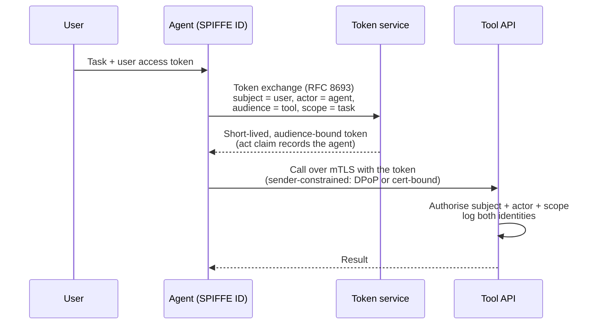

# Agentic AI Controls

A chatbot that gives a wrong answer causes confusion. An agent that takes a wrong action — refunds a payment, deletes a branch, emails a customer list — causes an incident. Agents hold credentials, call tools, keep memory and act at machine speed, which makes them closer to **high-privilege insiders** than to chat interfaces. That framing is the premise of Emmanuel Dahunsi's series *The Agentic AI Controls That Actually Matter* (Part 1: *Treat AI Agents As High-Privilege Insiders, Not Chatbots*), and of STRIDE-GPT's own [AI Insider Threat](../stride_gpt/core/prompts/threat_model/insider_threat.md) lens.

This page describes the agentic controls in the [control catalogue](controls-catalog.md#domain-agt) (`AGT-01` to `AGT-14`), a baseline that scales them with an agent's autonomy, and how STRIDE-GPT applies them when it threat-models an agentic system. Each control maps to the OWASP Top 10 for Agentic Applications, AIUC-1, ISO/IEC 42001 and the EU AI Act; see the [crosswalks](framework-crosswalks.md).

## Start with governance: inventory, owner, autonomy level

You cannot secure agents you don't know about. The first control, **AGT-01**, registers every production agent the way you would a privileged account:

- a **named, accountable owner** (AIUC-1 E004; ISO/IEC 42001 A.3.2);
- its **purpose**, model and version, tools and MCP servers, data scopes, credentials and environments (ISO/IEC 42001 A.4.2; ISO/IEC 27001 A.5.9);
- an **assigned autonomy level**, which determines every other control's strength.

Agents that aren't registered, or have no owner, are denied at runtime. Retire agents together with their credentials so none are orphaned. Starting with inventory, ownership and autonomy is the governance baseline Dahunsi's series argues for, and it is what makes the rest of the controls enforceable.

## Autonomy levels

STRIDE-GPT uses six deployment archetypes, extending the AI Insider Threat model with L0 (no autonomy) and L5 (fully autonomous):

| Level | Archetype | Human role | Risk |
|-------|-----------|------------|------|
| **L0** | No Autonomy | Pure tool: no decision-making, planning or chaining | None; no insider threat surface |
| **L1** | Human-as-Operator | Approves every action before it runs | Low; the residual risk is reviewer fatigue |
| **L2** | Human-as-Collaborator | Agent acts within scoped boundaries; some actions are auto-approved | Medium; auto-approved actions are the soft underbelly |
| **L3** | Human-as-Supervisor | Agent runs autonomously per task; a human reviews outputs, not actions | High |
| **L4** | Human-as-Auditor | Continuous or triggered execution with persistent access; humans review logs periodically | Critical |
| **L5** | Fully Autonomous | Persistent, self-directed agent; sets its own goals, acquires resources, spawns sub-agents; no human in the loop | Extreme; full insider threat surface at machine speed |

## A baseline by autonomy level

Risk scales steeply with autonomy, so control strength should too. The table below is STRIDE-GPT's suggested baseline, not a requirement of any one standard. ● = expected, ○ = recommended, — = rarely needed.

| Control | L0 | L1 | L2 | L3 | L4 | L5 |
|---------|----|----|----|----|----|----|
| [AGT-01](controls-catalog.md#agt-01) Inventory, named owner, autonomy level | ○ | ● | ● | ● | ● | ● |
| [AGT-02](controls-catalog.md#agt-02) Least-agency design | — | ● | ● | ● | ● | ● |
| [AGT-03](controls-catalog.md#agt-03) Distinct, verifiable agent identity | — | ○ | ● | ● | ● | ● |
| [AGT-04](controls-catalog.md#agt-04) Task-scoped, short-lived, delegated credentials | — | ○ | ● | ● | ● | ● |
| [AGT-05](controls-catalog.md#agt-05) Tool allow-listing, policy-enforced calls | — | ● | ● | ● | ● | ● |
| [AGT-06](controls-catalog.md#agt-06) Tool and MCP supply-chain integrity | — | ● | ● | ● | ● | ● |
| [AGT-07](controls-catalog.md#agt-07) Human approval for high-impact actions | — | every action | ● | ● | ● | ● autonomous safeguards |
| [AGT-08](controls-catalog.md#agt-08) Sandboxed, ephemeral execution | — | ○ | ● | ● | ● | ● hardened |
| [AGT-09](controls-catalog.md#agt-09) Memory and context integrity | — | ○ | ○ | ● | ● | ● |
| [AGT-10](controls-catalog.md#agt-10) Authenticated inter-agent communication (multi-agent only) | — | ○ | ● | ● | ● | ● mutual attestation |
| [AGT-11](controls-catalog.md#agt-11) Action-level, tamper-evident audit trail | — | ● | ● | ● | ● | ● immutable |
| [AGT-12](controls-catalog.md#agt-12) Behavioural monitoring and canaries | — | — | ○ | ● | ● | ● continuous |
| [AGT-13](controls-catalog.md#agt-13) Kill switch and rapid containment | — | ○ | ● | ● | ● drilled | ● drilled + autonomous failsafe |
| [AGT-14](controls-catalog.md#agt-14) Execution budgets and circuit breakers | — | ○ | ● | ● | ● | ● |
| [AI-01](controls-catalog.md#ai-01) Prompt-injection defences | — | ● | ● | ● | ● | ● |
| [AI-07](controls-catalog.md#ai-07) Adversarial testing and red teaming | — | ○ | ● | ● | ● independent | ● independent + continuous |

Three rules of thumb follow from the table. First, **L0 (pure tools) need only inventory** — they have no agency to govern. Second, **every level from L1 upward needs AGT-01, AGT-02, AGT-05, AGT-06 and AGT-11**: know the agent, constrain it, govern its tools and record what it does. Third, **from L3 upward, assume the agent will at some point act against your interests** — through prompt injection, a poisoned tool, or misalignment — and make sure you would detect it (AGT-12) and could stop it (AGT-13). **At L5, the agent has no human guardrail**: every control must be self-enforcing, with autonomous failsafes and immutable audit trails that survive the agent's own attempts to modify them.

## The controls, by what they stop

| Control | Stops | OWASP ASI |
|---------|-------|-----------|
| AGT-01 Inventory, owner, autonomy | Shadow agents; orphaned credentials; nobody accountable | ASI03, ASI10 |
| AGT-02 Least-agency design | Excessive agency: more autonomy, goals or actions than the task needs | ASI02, ASI10 |
| AGT-03 Agent identity | Shared service accounts; agents acting with a person's credentials; unattributable actions | ASI03, ASI07 |
| AGT-04 Delegated credentials | Long-lived keys in agent context; cross-workflow secret reuse; token theft and replay | ASI03, ASI02 |
| AGT-05 Tool allow-listing | Tool misuse: destructive calls, out-of-bounds parameters, unexpected targets | ASI02 |
| AGT-06 Tool supply chain | Malicious or "rug-pulled" MCP servers; poisoned tool descriptions | ASI04 |
| AGT-07 Human approval | Irreversible actions taken on the agent's word; approval fatigue; human-agent trust exploitation | ASI09, ASI02 |
| AGT-08 Sandboxing | Generated code escaping to the host or reaching the network | ASI05 |
| AGT-09 Memory integrity | Memory and context poisoning; cross-session and cross-tenant leakage | ASI06 |
| AGT-10 Inter-agent security | Agent impersonation; message tampering; privilege laundering through other agents | ASI07 |
| AGT-11 Audit trail | Repudiation; forensics that rely on what the agent *said* it did | ASI09, ASI10 |
| AGT-12 Monitoring and canaries | Undetected exfiltration, goal drift and rogue behaviour | ASI10, ASI01 |
| AGT-13 Kill switch | An incident you can see but cannot stop | ASI10, ASI08 |
| AGT-14 Budgets and circuit breakers | Runaway loops; denial-of-wallet; cascading failures across agents | ASI08 |

## Identity and delegation in practice

An agent acting for a user needs its own identity and a credential scoped to the task, never the user's token or a shared API key. The pattern combines workload identity (IAM-04, AGT-03) with OAuth token exchange (AGT-04):

- **Mint per task, expire in minutes.** Restrict the audience with resource indicators (RFC 8707) and revoke on task completion.
- **Inject credentials in the tool layer.** Never put them in the prompt, where the model can read, echo or exfiltrate them (AI-03, DAT-06).
- **Separate secret scopes by function.** An issue-triage agent must not share secrets with release workflows. This is a point Dahunsi makes in *The Supply Chain of Agency*.
- **MCP servers are OAuth resource servers.** The MCP authorization specification builds on OAuth 2.1 with resource indicators and protected-resource metadata, so the same pattern applies to tool servers.

## Tool supply chain: pin, verify, inventory

An MCP server can change a tool's description or schema after you approved it, a "rug pull", or hide instructions in a description that the model will read and follow (tool poisoning). AGT-06 treats tool definitions like any other dependency:

1. Allow-list MCP servers and plugins from vetted publishers; verify server identity (TLS or mTLS) and package signatures.
2. Pin each tool definition (name, description, schema) by hash when you approve it.
3. Before granting an agent access, compare the live definition with the pinned hash; on mismatch, block and alert.
4. Keep an AI bill of materials (AI-BOM) for every production agent: models, prompts, tools, MCP servers and versions (CycloneDX 1.6 ML-BOM can carry it).

Pinning tool definitions and blocking on mismatch, and keeping an AI-BOM per agent, are both recommendations from Dahunsi's *The Supply Chain of Agency*.

## Detect what the agent does, not what it says

Chain-of-thought is testimony, not evidence. Detection relies on **action-level** telemetry (AGT-11): every tool call with its arguments and a result digest, every approval, delegation and credential use, tagged with the agent, the delegating user, the session and the model and prompt version. Write it to storage the agent cannot modify (LOG-02), and use the OpenTelemetry GenAI semantic conventions so traces correlate with the rest of your estate.

On top of that, **AGT-12** baselines normal behaviour per agent and alerts on deviation: new tools, bulk reads, unusual egress, off-hours privilege use. It also plants **canaries** within the agent's reach — honey tokens, decoy records, a decoy MCP endpoint — where any touch is a high-fidelity signal.

## The kill switch

AGT-13 is the control you hope never to use and must be able to use in minutes:

- halt one instance, one agent type or the whole fleet;
- atomically revoke the agent's tokens, keys and tool access;
- fail safe: stop accepting tasks, abort in-flight actions, preserve state for forensics, and plan rollback of what the agent changed;
- let both the owner and the SOC trigger it, and **drill it**, because an untested kill switch is not a control.

For high-risk AI systems, the EU AI Act requires that people overseeing the system can "interrupt the system through a 'stop' button or a similar procedure" (Art. 14(4)(e)). AIUC-1 C009 (real-time feedback and intervention) and E001 (failure plan for security breaches) also apply.

## How STRIDE-GPT applies this

When STRIDE-GPT analyses an agentic codebase or description, the agent loads the `agentic` (OWASP ASI), `insider_threat` and `ai_controls` cards alongside the defaults. Each threat then carries its ASI code, its insider category and autonomy level, and the AGT controls that mitigate it. For example:

| Threat Type | Scenario | OWASP ASI | Insider Category | Controls |
|-------------|----------|-----------|------------------|----------|
| Elevation of Privilege | The support agent's refund tool accepts any amount and needs no approval, so an injected email can trigger a large refund. | ASI02 | | AGT-05, AGT-07, AI-01 |
| Information Disclosure | The agent's GitHub token is in its environment and the code-execution tool can read it. | ASI03 | Credential Compromise | AGT-04, AGT-08, DAT-06 |

The report's compliance section then shows, for instance, that AGT-07 addresses EU AI Act Art. 14 and AIUC-1 C007 and C009, while AGT-04 addresses AIUC-1 A008 (credential and secret leakage). Every one of those references comes from the catalogue, not from the model.

## Sources

- Emmanuel Dahunsi, *The Agentic AI Controls That Actually Matter* (Medium), Part 1: *Treat AI Agents As High-Privilege Insiders, Not Chatbots*; and *The Supply Chain of Agency* (Medium).
- OWASP GenAI Security Project, *Top 10 for Agentic Applications* (2026) and *Agentic AI – Threats and Mitigations*.
- Cloud Security Alliance, *Agentic AI Autonomy Levels and Control Framework* (2026).
- Matt Adams, [AI Insider Threat](https://ai-insider-threat.matt-adams.co.uk).
- Regulation (EU) 2024/1689 (AI Act), Art. 14; AIUC-1 (Q3 2026 revision).
- IETF RFC 8693 (OAuth 2.0 Token Exchange), RFC 8707 (Resource Indicators), RFC 9449 (DPoP); the MCP authorization specification; SPIFFE.
