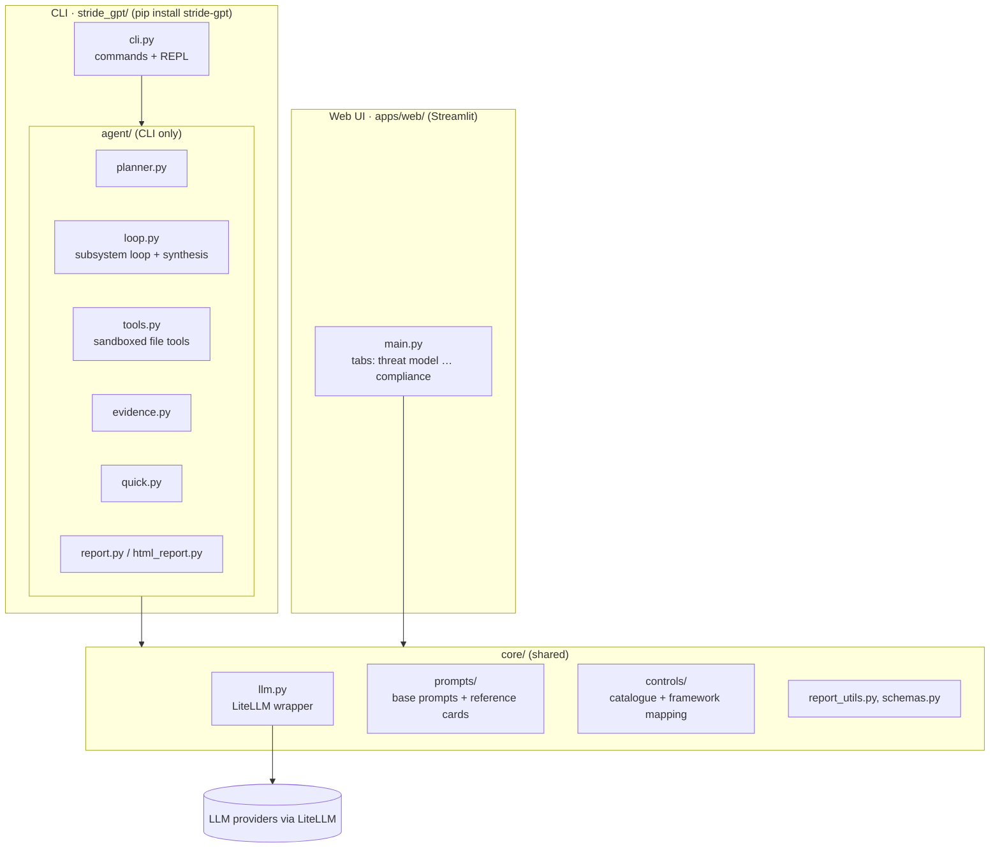
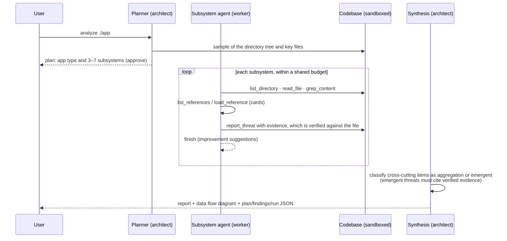
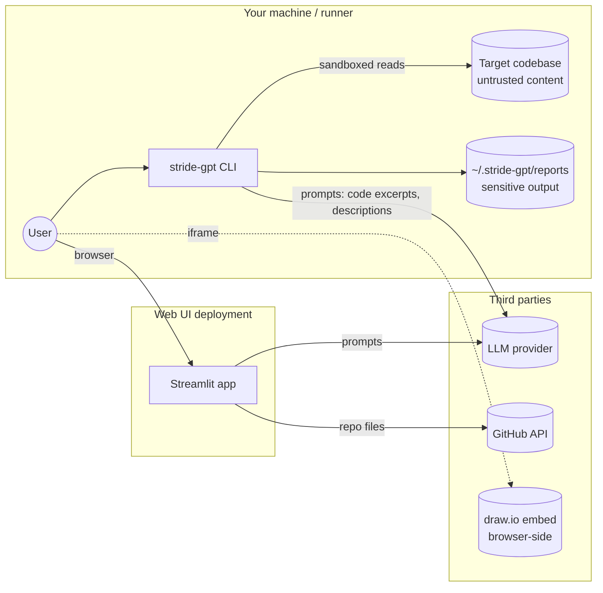

# Architecture

STRIDE-GPT is one Python library with two front ends. This page describes how the pieces fit together, how data moves between them, where the trust boundaries are, and where to extend the system. [AGENTS.md](../AGENTS.md) holds contributor-level detail: the progressive-disclosure pattern, provider quirks, and what not to do.

## Components

- **`stride_gpt/core/`** is shared. It holds the LLM abstraction (every call goes through `core/llm.py`), the prompts and reference cards, the control catalogue, the schemas and the shared report helpers.
- **`stride_gpt/agent/`** is the agentic engine. It is CLI-only by design, because filesystem-touching code doesn't belong in a hosted web app.
- **`apps/web/`** is the Streamlit UI. It imports from `core`, never from `agent`.

## The agentic analysis (`stride-gpt analyze`)

1. **Planning** is one architect call. It classifies the application (web, GenAI or agentic) and proposes subsystems; you approve the plan, or `-y` approves it for you.
2. **Exploration** runs a tool-using loop per subsystem. Threats are recorded one at a time through `report_threat`. Each evidence snippet is matched against the file and its line range recorded; each control ID is checked against the catalogue. A per-subsystem call budget and a tool budget bound the cost, and context compression keeps long explorations inside the model's window.
3. **Synthesis** is one architect call over all findings. Aggregations link to existing threat IDs and are not counted as threats. Emergent threats must cite verifiable evidence or they are dropped.
4. **Outputs:** the report (Markdown, JSON, SARIF or HTML), a system-level data flow diagram, and with `-o`, three JSON siblings: the plan, the findings and the run manifest. Checkpoints after each subsystem let `--resume` skip finished work, refusing if the git SHA or the configuration has changed.

`stride-gpt quick` is the same idea without a codebase: one agent turn loop with only the reference-card tools, producing a threat model from a written description.

## Reference cards and the control catalogue

The agent's system prompt (`base.md`) stays small. It advertises **reference cards**, markdown files with YAML frontmatter, and the agent loads only the ones each subsystem needs:

| Card | Adds | Source of truth |
|------|------|-----------------|
| `genai`, `agentic`, `insider_threat` | `OWASP_LLM`, `OWASP_ASI`, `INSIDER_CATEGORY`, `autonomy_level` | Hand-written markdown |
| `mitre_enterprise`, `mitre_atlas` | `MITRE_ATTACK` | Generated from MITRE STIX/YAML by `scripts/refresh_mitre_cards.py` |
| `security_controls`, `ai_controls` | `CONTROLS` | Generated from `core/controls/catalog.toml` by `scripts/build_control_catalog.py` |

Identifiers that come from a catalogue are never trusted blindly. MITRE technique IDs are normalised and filtered. Control IDs are validated against the catalogue, and framework references (AIUC-1, ISO/IEC 42001, EU AI Act, ISO/IEC 27001) are derived from them by lookup; the model never writes them. See [Controls and compliance mapping](controls-and-compliance.md).

## The web UI

The Streamlit app is a single-shot tool. It builds one prompt per task, sharing the same reference cards through `create_threat_model_prompt`, and renders the results in tabs: threat model, attack tree, data flow diagram, mitigations, DREAD, test cases and compliance. Inputs can be a description, an uploaded diagram (read by a vision model), a draw.io diagram drawn in the embedded editor (parsed with `defusedxml`), a guided questionnaire, or a GitHub repository fetched through the GitHub API. The app keeps state only in the user's session.

## Data flows and trust boundaries

Things to keep in mind across those boundaries:

- **Content you analyse is untrusted input.** A repository can contain instructions aimed at the model. Mitigations: tools sandboxed to the target with no VCS metadata, evidence verification, catalogue-constrained identifiers, and output escaping in every renderer.
- **Prompts leave your boundary.** Whatever the model sees goes to the provider you configured. Use local models for material that must not leave.
- **Reports are sensitive.** They map your weaknesses. Manifests redact paths and exclude keys and endpoints, so they are safe to commit, but the reports themselves need access control.
- **Hosted UIs need an identity layer.** The UI has no built-in authentication; see [Deployment hardening](deployment-hardening.md).

## Extension points

| To add | Do this |
|--------|---------|
| A threat lens (cloud, IoT, a regulation) | Drop a markdown card with frontmatter into `core/prompts/threat_model/`. Discovery is automatic; see [AGENTS.md](../AGENTS.md#adding-a-feature--orientation) for the field checklist |
| A control, domain or framework | Edit `core/controls/catalog.toml` and run `scripts/build_control_catalog.py`; see [Customising the catalogue](controls-and-compliance.md#customising-the-catalogue) |
| An agent capability | A tool in `agent/tools.py` (`AGENT_TOOLS` + `_TOOL_DISPATCH`), or a reporting tool handled in `agent/loop.py` |
| An output format | A renderer in `agent/report.py`, wired into `cli.py`'s `OutputFormat` |
| A model or provider | `stride_gpt/models.py` and a branch in `core/llm.py:_build_litellm_kwargs` |
