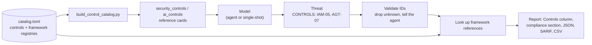

# Controls and Compliance Mapping

STRIDE-GPT tags each threat it finds with the security controls that would mitigate it, then maps those controls to the requirements of **AIUC-1**, **ISO/IEC 42001:2023**, the **EU AI Act** and **ISO/IEC 27001:2022**. The result answers three questions a threat model alone does not:

1. *What should we build?* The recommended controls, ranked by how many threats each one addresses.
2. *Which obligations do these threats touch?* For each framework, the requirements those controls address.
3. *Where is the evidence?* Every mapping is traceable from threat → control → requirement, in Markdown, HTML, JSON, SARIF and CSV.

This page explains how the mapping works, where it appears, what it does and doesn't tell you, and how to extend it. The control list itself is in the [control catalogue](controls-catalog.md); the same data organised by framework is in the [framework crosswalks](framework-crosswalks.md).

## How it works



1. **One source of truth.** `stride_gpt/core/controls/catalog.toml` defines every control, its STRIDE categories, the OWASP risks it addresses, and its references in each framework. Each framework also has a registry of valid references (for example all 38 ISO/IEC 42001 Annex A controls). The loader rejects the catalogue if any mapping points at a reference that isn't in the registry, so a typo fails CI rather than reaching a report.
2. **The model sees controls, never clauses.** `scripts/build_control_catalog.py` renders the catalogue into two [reference cards](../AGENTS.md#progressive-disclosure-pattern): `security_controls` (identity, data protection, network, logging, application security) and `ai_controls` (AI, agentic and AI-governance controls). The cards list control IDs, names and objectives, with no framework references, so the model is never prompted to cite an article or clause.
3. **The model picks IDs.** For each threat, the model chooses one to four control IDs, most important first. In `/analyze` they arrive through the `controls` argument of `report_threat`, which is constrained to catalogue IDs. In `/quick` and the web UI they come in the `CONTROLS` field of the JSON threat model.
4. **IDs are validated.** STRIDE-GPT keeps only IDs that exist in the catalogue. It tolerates harmless variation (`iam-5` → `IAM-05`, `"IAM-05 (JWT)"` → `IAM-05`), drops anything else, and in `/analyze` tells the model which IDs it dropped so it can correct itself. Synthesis output and saved `/quick` reports are filtered the same way.
5. **Framework references are looked up, not generated.** Each recommended control's references are rolled up per framework, with the controls and the number of threats behind each requirement. Every renderer recomputes this from the threats, so a live report and a re-render of the saved JSON always agree.

This is the same anti-hallucination contract STRIDE-GPT applies to MITRE ATT&CK technique IDs, taken one step further: the model never handles framework identifiers at all.

## Where it shows up

| Surface | What you get |
|---------|--------------|
| Markdown and HTML reports | A **Controls** column in the threat tables and a **Controls & Compliance Mapping** section: recommended controls, then one table per framework (requirement, controls, threat count) |
| JSON report (`-f json`, and the auto-saved copy) | A `compliance` object: catalogue version, AI scope, controls with their mappings, and per-framework requirements |
| SARIF | `properties.controls` and `properties.frameworks` on each result, for filtering in GitHub code scanning and similar tools |
| `stride-gpt controls --report <saved.json> -o mapping.csv` | One row per threat, control and requirement: `threat_type, scenario, control_id, control_name, framework, reference, requirement` |
| Web UI | The **Map threats to security controls and compliance frameworks** option (on by default) and a **Compliance** tab with Markdown, CSV and JSON downloads |

The `compliance` block in JSON looks like this (abridged):

```json
{
  "catalog_version": "2026.10",
  "ai_scope": true,
  "controls": [
    {"id": "AGT-07", "name": "Risk-tiered human approval for high-impact actions",
     "domain": "AGT", "threat_count": 2,
     "mappings": {"aiuc_1": ["B006", "C007", "C009"], "iso_42001": ["A.9.2"],
                  "eu_ai_act": ["Art. 14", "Art. 26"]}}
  ],
  "frameworks": [
    {"key": "eu_ai_act", "name": "EU AI Act",
     "refs": [{"ref": "Art. 14", "title": "Human oversight",
               "controls": ["AI-08", "AGT-07"], "threat_count": 3}]}
  ],
  "omitted_frameworks": []
}
```

CSV exports neutralise cells that a spreadsheet would treat as formulas. Scenario text is model output, and whoever wrote the application description could have steered it.

## When AI frameworks are shown

AIUC-1, ISO/IEC 42001 and the EU AI Act regulate AI systems. A missing TLS check in a plain web application bears on ISO/IEC 27001, not on the EU AI Act. So a report shows the AI frameworks only when at least one threat concerns an AI system, meaning it carries any of:

- an OWASP LLM or Agentic (ASI) code,
- an AI insider-threat category,
- a MITRE ATLAS technique (`AML.*`), or
- a control from the AI, agentic or AI-governance domains.

Otherwise the compliance section lists ISO/IEC 27001 only and says the AI frameworks were omitted. If your system uses AI but the report shows no AI frameworks, the model didn't load the AI reference cards. That is visible in the run manifest's `references_loaded`, and usually means the description didn't mention the AI components.

## Frameworks

### AIUC-1

[AIUC-1](https://www.aiuc-1.com/) is an auditable standard for AI agents, organised into six domains: **A. Data & Privacy**, **B. Security**, **C. Safety**, **D. Reliability**, **E. Accountability** and **F. Society**. It is revised quarterly. The catalogue references requirement IDs and titles as published after the **Q3 2026 revision**, which added A008 (credential and secret leakage) and retired E007 and E014. Testing requirements such as B001, C010–C012, D002 and D004 map to the red-teaming control `AI-07`. Organisational requirements like E004 (accountability) and E010 (acceptable use) map to the governance controls.

### ISO/IEC 42001:2023

ISO/IEC 42001 specifies an **AI management system** (AIMS). Its Annex A contains 38 reference controls under nine objectives (A.2 to A.10), covering AI policy, roles, resources, impact assessment, the AI system life cycle, data, information for interested parties, use, and third parties.

ISO/IEC 42001 doesn't restate generic information-security controls. Its Annex A is AI-specific, and organisations usually take security controls from ISO/IEC 27001, often running the two management systems together. So the catalogue maps identity, cryptography and network controls to **ISO/IEC 27001** and gives them an ISO/IEC 42001 reference only where an AI-specific control genuinely applies. Examples are A.6.2.8 (event logs) for logging and A.10.3 (suppliers) for supply-chain controls. In an AIMS, you would justify the generic controls through AI risk treatment (clause 6.1.3) and record them in your Statement of Applicability.

### EU AI Act

The [AI Act](https://eur-lex.europa.eu/eli/reg/2024/1689/oj) is Regulation (EU) 2024/1689. It was amended by the Digital Omnibus on AI, Regulation (EU) 2026/1744, which was published in the Official Journal on 24 July 2026 and entered into force on 27 July 2026. Obligations depend on the system's risk class and your role (provider or deployer):

| Applies from | Obligations |
|--------------|-------------|
| 2 February 2025 | Prohibited practices (Art. 5) and AI literacy (Art. 4) |
| 2 August 2025 | General-purpose AI model obligations (Art. 53, and Art. 55 for systemic risk) |
| 2 August 2026 | Transparency obligations (Art. 50). Machine-readable marking under Art. 50(2) has a transitional period until 2 December 2026 for systems placed on the market before 2 August 2026 |
| 2 December 2027 | High-risk AI systems listed in Annex III (deferred from 2 August 2026 by Regulation (EU) 2026/1744) |
| 2 August 2028 | High-risk AI systems that are safety components of products under Annex I (deferred from 2 August 2027) |

The catalogue cites specific provisions where it can. Examples are **Art. 15(5)** (cybersecurity, including data and model poisoning and adversarial examples), **Art. 14(4)(e)** (the ability to interrupt the system with a "stop" button, for the agent kill switch), **Art. 12** with **Art. 19** and **Art. 26** (automatic logging, and keeping logs for at least six months), and **Art. 50(1)–(2)** (telling people they are dealing with AI, and marking synthetic content). Articles 9–15, 17, 19, 26, 27 and 72–73 apply to **high-risk** systems; check your classification under Art. 6 and Annex III first.

### ISO/IEC 27001:2022

[ISO/IEC 27001](https://www.iso.org/standard/27001) Annex A lists 93 information-security controls in four themes. It is the natural home for identity, cryptography, network, logging and secure-development controls, and the only framework shown for reports that don't concern an AI system.

### OWASP

The application-security controls are grounded in the **OWASP Top 10:2025** and **ASVS 5.0**. The AI and agentic controls address the **OWASP Top 10 for LLM Applications (2025)** and the **Top 10 for Agentic Applications (2026)**. Every one of those 30 risks is mitigated by at least one control; the [crosswalk](framework-crosswalks.md#owasp) lists which.

## What the mapping is and isn't

**It is:**

- A traceable link from each identified threat to the controls that would mitigate it, and from each control to the framework requirements it helps satisfy.
- A prioritised starting point for a gap analysis, a Statement of Applicability, or a remediation backlog.
- Evidence that risks were identified systematically. Threat modelling supports ISO/IEC 42001 AI risk assessment (6.1.2) and the risk identification the EU AI Act requires of high-risk systems (Art. 9).

**It isn't:**

- **A conformity assessment.** A threat model sees threats, not your operating controls. A requirement listed in the report means the identified threats bear on it, not that you are or aren't compliant.
- **Exhaustive.** Only controls relevant to the threats found appear. Many framework requirements are organisational, such as policy review or human resources, and no threat model will surface them. The [crosswalks](framework-crosswalks.md) list them as "not addressed by a catalogue control".
- **A reproduction of the standards.** ISO requirement titles are abbreviated, and ISO/IEC 42001 and 27001 text is copyrighted, so work from licensed copies for audit purposes.
- **Legal advice.** EU AI Act obligations depend on your system's classification and your role; involve counsel.

Mappings are deliberately conservative. A control is mapped only where it directly helps satisfy the requirement, and left unmapped rather than stretched. Each mapping is reviewable in `catalog.toml`.

## Customising the catalogue

Fork-friendly by design: edit the TOML, regenerate, run the tests.

```bash
$EDITOR stride_gpt/core/controls/catalog.toml
python scripts/build_control_catalog.py     # regenerates the cards and both docs pages
uv run pytest tests/test_controls.py        # integrity checks + drift guard
```

**Add a control.** Append a `[[controls]]` entry with a new ID in its domain's sequence (`IAM-11`). Give it a one-sentence `objective` (the model reads it), `guidance` bullets (only the docs show these), `stride` letters, the OWASP codes it `mitigates`, `references`, and a `[controls.mappings]` table. IDs are stable once published: never renumber or reuse one, because saved reports refer to them.

**Add a domain or your own controls.** Add a `[domains.ORG]` table naming the card it renders into. To keep organisation-specific controls in their own card, add a `[cards.org_controls]` table; the generator creates `org_controls.md` and the agent discovers it automatically through `list_references`. If a card adds a new field rather than reusing `CONTROLS`, follow the card checklist in [AGENTS.md](../AGENTS.md#adding-a-feature--orientation).

**Add a framework.** Add a `[frameworks.<key>]` table with `name`, `full_name`, `version`, `url`, `ai_specific`, `note` and a `refs` registry, then add `<key> = [...]` mappings to the controls it relates to. It appears in every report, export and crosswalk with no code changes. To use it with `stride-gpt controls --framework`, add it to `FrameworkChoice` in `stride_gpt/cli.py`.

## Sources

- AIUC-1 standard, [aiuc-1.com](https://www.aiuc-1.com/) and standard.aiuc-1.com (Q3 2026 revision).
- ISO/IEC 42001:2023, *Information technology — Artificial intelligence — Management system*.
- ISO/IEC 27001:2022, *Information security, cybersecurity and privacy protection — Information security management systems — Requirements*.
- Regulation (EU) 2024/1689 (Artificial Intelligence Act), [EUR-Lex](https://eur-lex.europa.eu/eli/reg/2024/1689/oj); Regulation (EU) 2026/1744 (Digital Omnibus on AI), [EUR-Lex](https://eur-lex.europa.eu/eli/reg/2026/1744/oj).
- OWASP [Top 10:2025](https://owasp.org/Top10/2025/), [ASVS 5.0](https://owasp.org/www-project-application-security-verification-standard/), [Top 10 for LLM Applications 2025](https://genai.owasp.org/llm-top-10/), [Top 10 for Agentic Applications 2026](https://genai.owasp.org/).
