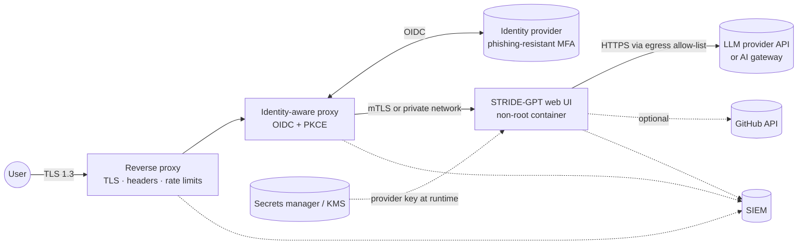

# Deployment Hardening

STRIDE-GPT is built for a single user on their own machine. The moment a team shares the web UI, or the CLI runs in CI, it becomes a system that holds LLM provider keys, reads source code, sends it to a third party, and produces documents that describe your weaknesses. This guide secures it, applying the [control catalogue](controls-catalog.md) to STRIDE-GPT itself.

The configuration snippets are starting points. Adapt them to your environment and test them before relying on them.

## Threat model of STRIDE-GPT

| Threat | STRIDE | Controls |
|--------|--------|----------|
| The web UI has no built-in authentication, so anyone who can reach it can use it and spend the server's provider key | Spoofing, Denial of Service | IAM-01, IAM-02, NET-06, APP-08 |
| Instructions planted in an analysed repository (a README, code comments) steer the model to omit threats or to emit hostile markdown | Tampering | AI-01, AI-02, APP-03 |
| Provider API keys leak through `.env` files, container environments, logs or CI output | Information Disclosure | DAT-06, LOG-01 |
| Descriptions, code and finished threat models reach the LLM provider, saved reports, browser downloads and CI artefacts | Information Disclosure | DAT-01, DAT-02, NET-05, GOV-04 |
| A CI checkout's credentials are in reach of the model-driven file tools | Information Disclosure | DAT-06, AGT-04 |
| Repeated or oversized generations run up the provider bill (denial of wallet) | Denial of Service | APP-08, LOG-05 |
| A compromised dependency or base image ships in the UI image | Tampering, Elevation of Privilege | APP-04, APP-05, APP-06 |
| No record of who generated which threat model, with which model and settings | Repudiation | LOG-01, LOG-02 |

Several of these are already mitigated in the code. The rest is configuration, covered below.

## What STRIDE-GPT already does

- **Sandboxed file tools.** The agent's `read_file`, `grep_content` and `list_directory` resolve every path inside the target directory. They refuse traversal, symlinks that point outside, and version-control metadata (`.git`, `.hg`, `.svn`), which is where `actions/checkout` writes the job token. Model-supplied regexes are length-capped and screened for catastrophic backtracking.
- **Evidence verification.** Quoted snippets are checked against the file on disk, so a model steered by planted instructions cannot fabricate code evidence unnoticed.
- **Output encoding.** Model text is escaped in markdown tables (pipes and newlines) and with `html.escape` throughout the HTML report. Mermaid runs with `securityLevel: 'strict'`. Control IDs and MITRE IDs are filtered to their catalogues before rendering.
- **Hardened parsing.** Uploaded draw.io XML is parsed with `defusedxml`, and the editor's `postMessage` origin is scoped to the configured draw.io host.
- **Shareable run manifests.** Manifests exclude API keys and endpoints and redact filesystem paths.
- **Supply chain.** Every dependency is pinned in `uv.lock`, the base image is pinned by digest, and CI runs Bandit, CodeQL, pip-audit, Gitleaks and Trivy.
- **Container defaults.** The UI image runs as a non-root user, and `docker-compose.yml` drops all Linux capabilities and sets `no-new-privileges` and resource limits.

## Reference architecture for a shared web UI



Only the reverse proxy is reachable from users. The app container is reachable only from the identity-aware proxy, and it can only reach the provider APIs it needs.

## Identity and access management

### Authentication: OIDC at an identity-aware proxy (IAM-01, IAM-02)

Put an identity-aware proxy in front of the app rather than adding login code to it: [oauth2-proxy](https://oauth2-proxy.github.io/oauth2-proxy/), a cloud identity-aware proxy, or your API gateway's OIDC integration. Have the IdP enforce phishing-resistant MFA (FIDO2/WebAuthn passkeys, or X.509 smart cards). An oauth2-proxy starting point:

```bash
oauth2-proxy \
  --provider=oidc \
  --oidc-issuer-url=https://login.example.com/ \
  --client-id=stride-gpt \
  --code-challenge-method=S256 \
  --email-domain=example.com \
  --cookie-secure=true \
  --cookie-samesite=lax \
  --reverse-proxy=true \
  --http-address=0.0.0.0:4180 \
  --upstream=http://stridegpt-ui:8501
# Client and cookie secrets come from the environment, injected from your
# secrets manager: OAUTH2_PROXY_CLIENT_SECRET, OAUTH2_PROXY_COOKIE_SECRET.
```

Streamlit keeps a WebSocket open at `/_stcore/stream`, so any proxy in the path must pass WebSocket upgrades.

### Authorisation (IAM-06, IAM-07)

- **Restrict who can use it** at the proxy: an email domain, or an IdP group (oauth2-proxy `--allowed-group` with your provider's groups claim). Threat models describe weaknesses, so treat access as need-to-know.
- **Keep the provider key least-privileged.** Use a project-scoped key with a spending cap, separate keys per environment, and rotation on any suspected exposure. In the web UI, users can bring their own key instead; it stays in their browser session.
- **If anything downstream consumes the proxy's tokens** (for example `--pass-authorization-header` forwarding the ID token), validate them as IAM-05 describes: pinned issuer keys, allow-listed algorithms, and `iss`, `aud`, `exp` and `typ` checks.

### Workload identity and mTLS (IAM-03, IAM-04, DAT-05)

Identity headers set by the proxy are only trustworthy if nothing else can reach the app. Either:

- **Kubernetes:** run a service mesh in STRICT mTLS mode, so the proxy and app authenticate with short-lived X.509 workload certificates (SPIFFE IDs), and add an authorisation policy that allows only the proxy's identity to call the app; or
- **Docker Compose:** put the app on an `internal: true` network shared only with the proxy, and publish no ports from the app container.

For a direct proxy-to-app mTLS hop, terminate it in a sidecar such as Envoy. Streamlit's own `server.sslCertFile` and `server.sslKeyFile` options serve TLS but don't verify client certificates. If your users authenticate with device certificates, nginx can require them at the edge:

```nginx
ssl_client_certificate /etc/nginx/tls/device-ca.pem;  # CA that issues device certificates
ssl_verify_client      on;
```

## Data protection

### Encryption in transit (DAT-04)

Terminate TLS 1.3 at the edge, allowing TLS 1.2 only with AEAD suites, and send HSTS:

```nginx
server {
    listen 443 ssl;
    http2 on;
    server_name stride-gpt.example.com;

    ssl_certificate     /etc/nginx/tls/server.crt;
    ssl_certificate_key /etc/nginx/tls/server.key;
    ssl_protocols       TLSv1.2 TLSv1.3;

    add_header Strict-Transport-Security "max-age=63072000; includeSubDomains" always;
    add_header X-Content-Type-Options    "nosniff" always;
    add_header Referrer-Policy           "no-referrer" always;
    # SAMEORIGIN, not DENY: Streamlit renders custom components (the diagram
    # editor) in same-origin iframes.
    add_header X-Frame-Options           "SAMEORIGIN" always;

    location / {
        proxy_pass         http://oauth2-proxy:4180;
        proxy_http_version 1.1;
        proxy_set_header   Upgrade $http_upgrade;
        proxy_set_header   Connection "upgrade";
        proxy_set_header   Host $host;
        proxy_set_header   X-Forwarded-Proto https;
        proxy_read_timeout 1h;
    }
}
```

Outbound calls to model providers use HTTPS with certificate verification. If a corporate TLS-inspection proxy sits in the way, add its CA with `SSL_CERT_FILE` or `REQUESTS_CA_BUNDLE`; never disable verification.

### Encryption at rest with customer-managed keys (DAT-02, DAT-03)

- **Web UI:** keeps nothing server-side beyond the session. Downloads land on users' machines, so endpoint disk encryption covers them.
- **CLI:** saves every report to `~/.stride-gpt/reports/`, plus `-o` files and checkpoints. On workstations, rely on full-disk encryption. On servers and CI runners, put that directory on an encrypted volume.
- **Archived reports** in object storage or a GRC system should be encrypted with a customer-managed key (AWS KMS, Google Cloud KMS, Azure Key Vault), with `Decrypt` granted only to the roles that need to read threat models.

### Secrets (DAT-06)

Inject provider keys at runtime from a secrets manager or Docker or Kubernetes secrets. Keep `.env` files to personal machines; they are git-ignored and gitleaks-scanned, but they remain plaintext. Never bake keys into images: anyone who can pull the image could read them.

### What leaves the boundary (DAT-01, GOV-04)

Everything you analyse is sent to your chosen provider. Classify before you analyse: send restricted material only to a local model (LM Studio), or to a provider whose data-use, retention and residency terms you have reviewed.

## Network security

### Egress allow-list (NET-02)

The UI container needs outbound HTTPS only to the provider you use, plus GitHub if you use repository analysis:

| Purpose | Host |
|---------|------|
| OpenAI | `api.openai.com` |
| Anthropic | `api.anthropic.com` |
| Google AI | `generativelanguage.googleapis.com` |
| Mistral | `api.mistral.ai` |
| Groq | `api.groq.com` |
| DeepSeek | `api.deepseek.com` |
| OpenRouter | `openrouter.ai` |
| GitHub repository analysis | `api.github.com` (or your GitHub Enterprise host) |

Deny everything else, including cloud metadata endpoints. Three settings reduce what is needed further:

- `STREAMLIT_BROWSER_GATHER_USAGE_STATS=false` turns off Streamlit's usage telemetry.
- `LITELLM_LOCAL_MODEL_COST_MAP=True` makes LiteLLM use its bundled model price map instead of fetching it at start-up.
- `TIKTOKEN_CACHE_DIR`, pre-populated at image build, gives exact token counts without allowing `openaipublic.blob.core.windows.net`. Without it, token estimates fall back to an approximation.

Two other endpoints are fetched by the *user's browser*, not the server: the diagram editor (`embed.diagrams.net`, or your own host via `STRIDE_GPT_DRAWIO_URL`) and the Tailwind and Mermaid CDNs used by HTML reports.

### Private connectivity to models (NET-05)

To keep model traffic off the internet, run an AI gateway you control, such as a LiteLLM proxy, that reaches providers over their private endpoints where offered (Private Link, PrivateLink, Private Service Connect). Point STRIDE-GPT at it with the LM Studio provider's custom base URL, which accepts any OpenAI-compatible endpoint. The gateway is also the natural place for central quotas, logging and data loss prevention.

### MACsec and IPsec (NET-03, NET-04)

These protect links, not applications, so they matter when STRIDE-GPT talks to models you host:

- If the UI or the CLI runners reach a self-hosted model server (an LM Studio or vLLM GPU cluster) in another site or data centre, carry that traffic over **IPsec** (IKEv2, certificate authentication, AES-256-GCM, perfect forward secrecy) or a private interconnect.
- Within or between data centres, enable **MACsec** (IEEE 802.1AE, GCM-AES-256, fail-closed) on the links that carry prompts, code and model weights.

Both are hop-by-hop, so keep TLS end to end as well. For SaaS model APIs reached over the internet, TLS is the relevant control.

### Segmentation and edge protection (NET-01, NET-06, APP-08)

Run the UI in its own segment with default-deny east-west policy. At the edge, rate-limit by user identity and IP, cap request sizes, and consider a WAF. Generation is expensive, and rate limits are your denial-of-wallet control.

## Logging and monitoring

- **Who did what (LOG-01).** Forward reverse-proxy and identity-aware-proxy access logs, which carry the authenticated user, to your SIEM along with the container's logs. Don't log request bodies: they contain application descriptions and code.
- **Audit trail for CLI runs (LOG-02).** Run `analyze` and `quick` with `-o`. The `<stem>.run.json` manifest records models, a prompt and configuration hash, the git SHA, which reference cards loaded, token usage and the run status. Commit it or attach it alongside the report, and keep reports and manifests in tamper-evident storage for as long as your policy requires.
- **Detection (LOG-03, LOG-05).** Alert on authentication anomalies at the proxy and on provider spend: set budget alerts in the provider console, and use the run manifest's token usage to spot runs that cost far more than usual.
- **Incident response (LOG-04).** Add "provider API key exposed" and "threat model leaked" to your playbooks: revoke and rotate the key, and treat a leaked report as a disclosure of your vulnerabilities.

## Application security (OWASP)

- Keep the image current. Rebuild on the release cadence so `apt-get upgrade`, the pinned digest and `uv.lock` updates land, and scan it (Trivy) before deploying (APP-04, APP-05).
- Keep Streamlit's XSRF protection on (`STREAMLIT_SERVER_ENABLE_XSRF_PROTECTION=true`, as `docker-compose.yml` sets) and run headless.
- Run the container as shipped: non-root, all capabilities dropped, `no-new-privileges`. Never mount the Docker socket (APP-06).
- Set the response headers in the nginx example above. Streamlit's frontend relies on inline styles, so a strict Content-Security-Policy needs testing against your Streamlit version before you enforce it; start in report-only mode.
- Review model output before acting on it. STRIDE-GPT escapes what it renders, but a generated mitigation or test case is still model output (AI-02).

## The CLI in CI/CD

```yaml
permissions:
  contents: read
  security-events: write          # only for uploading SARIF
steps:
  - uses: actions/checkout@<pinned-sha>
    with:
      persist-credentials: false  # keep the job token out of .git/config
  - run: pipx install stride-gpt
  - run: >-
      stride-gpt analyze . -y --worker-model anthropic/claude-sonnet-5
      -o stride.sarif -f sarif --max-llm-calls 25
    env:
      STRIDE_GPT_API_KEY: ${{ secrets.STRIDE_GPT_API_KEY }}
  - uses: github/codeql-action/upload-sarif@<pinned-sha>
    with:
      sarif_file: stride.sarif
```

- Pin actions by commit SHA. Grant the job only the permissions above (APP-04).
- `persist-credentials: false` keeps the token out of the checkout entirely, on top of the agent's own refusal to read `.git` (DAT-06).
- Never run analysis with secrets on untrusted fork pull requests (for example from `pull_request_target`). Fork code would control what the model reads, with your provider key in the environment.
- Cap cost with `--max-llm-calls` and `--max-tool-calls`, and a provider spending limit (APP-08).
- SARIF results carry `controls` and `frameworks` properties, so code-scanning alerts can be triaged by control or by regulation.

## Control summary

| Area | Controls applied to a STRIDE-GPT deployment |
|------|---------------------------------------------|
| Identity and access | IAM-01, IAM-02 (OIDC + MFA at the proxy); IAM-03, IAM-04 (workload certificates); IAM-05 (token validation); IAM-06, IAM-07 (who may use it; least-privilege keys) |
| Data protection | DAT-01 (classify before analysing); DAT-02, DAT-03 (CMEK for archived reports); DAT-04 (TLS 1.3 edge); DAT-05 (mTLS to the app); DAT-06 (secrets manager) |
| Network | NET-01 (segment); NET-02 (egress allow-list); NET-03, NET-04 (MACsec, IPsec for self-hosted models); NET-05 (private model access); NET-06 (edge rate limits) |
| Logging and monitoring | LOG-01 (identity-tagged access logs); LOG-02 (run manifests, tamper-evident storage); LOG-03 (SIEM alerting); LOG-04 (key-exposure playbook); LOG-05 (spend alerts) |
| Application security | APP-03 (output encoding, already built in); APP-04, APP-05 (pinned, scanned supply chain); APP-06 (hardened container); APP-08 (rate limits) |
| AI-specific | AI-01, AI-02 (repository content is untrusted input; review model output); GOV-04 (provider due diligence) |
