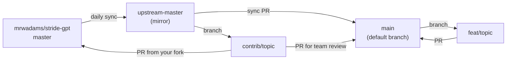

# Working in Nexus-stride-gpt

Nexus-stride-gpt is where we improve [STRIDE-GPT](https://github.com/mrwadams/stride-gpt) together. It holds STRIDE-GPT's code plus our enhancements, and it shares upstream's git history: upstream updates arrive as ordinary pull requests, and changes can still go back upstream.

This page covers how work moves between this repository and upstream. For setup, checks and code conventions, see [CONTRIBUTING.md](../CONTRIBUTING.md). For how the code fits together, see [AGENTS.md](../AGENTS.md).

## Branches



| Branch | Holds | Changes through |
| --- | --- | --- |
| `main` | STRIDE-GPT plus everything the team has merged. The default branch. | Pull requests only |
| `upstream-master` | An exact mirror of upstream's `master`, with its full history | The sync workflow. Never commit here. |
| `contrib/<topic>` | A change meant for upstream, cut from upstream's `master` | Team review here, then a pull request upstream from your own fork |
| `feat/<topic>`, `fix/<topic>` | A change for this repository only, cut from `main` | A pull request into `main` |

Two rules keep this working:

1. **Work headed upstream starts from upstream's code, never from `main`.** `main` carries this repository's own files, such as its Apache-2.0 `LICENSE`, `LICENSE-MIT`, `NOTICE` and our enhancements, and none of that belongs in an upstream pull request. The *Lane guard* check on pull requests into `main` catches a `contrib/*` branch that carries them.
2. **Upstream wins.** When upstream changes code we also changed, take upstream's version, unless we're diverging on purpose and the pull request says why.

## Pick a lane

Ask one question: **should `mrwadams/stride-gpt` get this change?**

- **Yes, or probably**: use Lane 1, a `contrib/<topic>` branch. Bug fixes, new reference cards, provider fixes, and tests or docs for existing behaviour belong here.
- **No**: use Lane 2, a `feat/<topic>` or `fix/<topic>` branch. For example: the controls catalogue and compliance mapping, this repository's own docs and tooling, or a change upstream declined.

If you're unsure, pick Lane 1. Moving a change into `main` later is easy; untangling this repository's files out of an upstream pull request is not.

## One-time setup

```bash
git clone https://github.com/aisecnomad/Nexus-stride-gpt.git
cd Nexus-stride-gpt
git remote add upstream https://github.com/mrwadams/stride-gpt.git
git fetch upstream
uv sync
```

Lane 1 also needs your own fork of STRIDE-GPT, because upstream accepts pull requests only from forks of `mrwadams/stride-gpt`:

```bash
gh repo fork mrwadams/stride-gpt --clone=false
git remote add fork https://github.com/<your-github-username>/stride-gpt.git
```

## Lane 1: changes for upstream (`contrib/*`)

1. **Check upstream first.** Search [upstream issues and pull requests](https://github.com/mrwadams/stride-gpt/issues?q=) for the same idea, and open an issue there before you build anything large.
2. **Branch from upstream's latest `master`:**

   ```bash
   git fetch upstream
   git switch -c contrib/<topic> upstream/master
   ```

3. **Make the change** and run the [checks](#before-you-open-a-pull-request).
4. **Open a pull request into `main` here** for team review. CI, the security scans and *Lane guard* run on it. Once it's approved, a maintainer merges it with **Create a merge commit**, so the team can build on it straight away.
5. **Propose the same branch upstream** from your fork:

   ```bash
   git push fork contrib/<topic>
   ```

   On GitHub, open a pull request from `<your-github-username>:contrib/<topic>` into `mrwadams/stride-gpt` `master`, then paste its link into the Nexus pull request.
6. **Answer upstream's review on the same branch** and push it to `fork`. `main` picks up the final version when upstream merges it.
7. **After upstream merges it**, the next sync brings it into `main`. If upstream declines it, decide as a team whether `main` keeps it as a Nexus-only change or reverts it.

Keep the branch current with `git rebase upstream/master`. Never merge or rebase `main` into a `contrib/*` branch.

**Licensing.** This repository's own code is Apache-2.0, and STRIDE-GPT is MIT. An upstream pull request contributes your change under upstream's MIT license, so send only code you can license that way, such as your own work on a `contrib/*` branch. Don't send other people's Apache-2.0 work from `main` upstream without their agreement.

## Lane 2: changes for this repository only

```bash
git fetch origin
git switch -c feat/<topic> origin/main
```

Open the pull request into `main`. Where you can, put Nexus-only changes in new files rather than editing upstream's: every edit to an upstream file is a future merge conflict.

## Before you open a pull request

Run the checks CI runs:

```bash
uv lock --check
uv run ruff check .
uv run pytest
```

Also run anything else [CONTRIBUTING.md](../CONTRIBUTING.md) lists.

## Security

This repository is public: code, branch names, commit messages, issues and pull requests are visible to everyone.

- **A vulnerability in code upstream also has** (anything on `upstream-master`): report it privately to upstream with **Report a vulnerability** on the [STRIDE-GPT Security tab](https://github.com/mrwadams/stride-gpt/security). Fix it through upstream's advisory process, not on a `contrib/*` branch here: a public branch is a public disclosure.
- **A vulnerability only this repository has**, for example in the controls catalogue: report it privately with **Report a vulnerability** on this repository's **Security** tab. A maintainer fixes it in a draft security advisory's temporary private fork.
- Until a fix is released, keep exploit details out of commit messages, pull request titles and branch names.

## Maintainers

### Syncing with upstream

The *Nexus upstream sync* workflow (`.github/workflows/nexus-upstream-sync.yml`) runs daily and on demand from the Actions tab. It:

1. **Fast-forwards `upstream-master`** to upstream's `master`. If the mirror has commits upstream doesn't, it fails rather than guess: move those commits to a branch, then reset the mirror to upstream.
2. **Opens a pull request from `upstream-master` into `main`** when `main` is behind. Merge it with **Create a merge commit**, never squash or rebase: those cut `main` off from upstream's history, and later syncs would conflict. Resolve conflicts in upstream's favour unless the Nexus change is deliberate.

Out of the box it uses the built-in `GITHUB_TOKEN`, which has two limits:

- It can't push commits that change `.github/workflows/`. When upstream changes a workflow, the run fails and says so. Update the mirror by hand:

  ```bash
  git fetch upstream
  git push origin upstream/master:upstream-master
  ```

- It can't open the sync pull request unless **Allow GitHub Actions to create and approve pull requests** is on (Settings → Actions → General). Leave that setting off, because it also lets any workflow approve pull requests. The run summary links to a ready-made compare page, so opening the pull request yourself takes one click.

A `NEXUS_SYNC_TOKEN` secret removes both limits:

1. Create a [fine-grained personal access token](https://github.com/settings/personal-access-tokens/new) with access to **only this repository**; Contents, Pull requests and Workflows permissions, each *Read and write*; and an expiry of 90 days or less, with a reminder to rotate it.
2. Settings → Environments → `upstream-sync` (the first sync run creates it, or create it with **New environment**). Under **Deployment branches and tags**, choose **Selected branches and tags** and add `main`.
3. In the same environment, add the token as an **environment secret** named `NEXUS_SYNC_TOKEN`.

Never store it as a repository secret. Any collaborator can push a branch whose workflow reads repository secrets, and *Pull requests: write* lets the token approve pull requests as you, which would defeat required reviews. The environment releases the token only to workflows running on `main`, which changes only through reviewed pull requests.

### If `main` falls out of step with upstream's history

The link between `main` and upstream's history lives in merge commits. If a sync pull request is squashed, the next sync either fails with *main isn't linked to upstream's history* or proposes upstream commits that `main` already has. Once `main` really does contain everything on `upstream-master`, record that with a merge that changes no files, and merge its pull request with **Create a merge commit**:

```bash
git fetch origin
git switch -c fix/relink-upstream origin/main
git merge -s ours --allow-unrelated-histories origin/upstream-master -m "Record upstream-master as merged"
git push origin fix/relink-upstream
```

### One-time repository settings

1. **Rulesets** (Settings → Rules → Rulesets), each with an empty bypass list:
   - `upstream-master`: block force pushes and restrict deletions. Do not require linear history: the exact mirror must retain upstream's merge commits, and that rule would reject a fast-forward that brings in a new merge commit.
   - `main`: require a pull request (one approval once there are two or more maintainers); require the status checks `Lint (ruff)`, `Test (Python 3.12)`, `Test (Python 3.13)`, `Test (Python 3.14)` and `Lane guard`; block force pushes; restrict deletions. Don't require linear history: sync pull requests need merge commits.
2. **Merge options** (Settings → General → Pull Requests): keep **Allow merge commits** on.
3. **Release workflow**: Actions → *Release* → **⋯** → **Disable workflow**. It publishes upstream's PyPI package and Docker image, which can't succeed from here and shouldn't be attempted.
4. **Dependabot**: upstream's `.github/dependabot.yml` is live here, because this isn't a fork, so Dependabot opens pull requests against `main`. They change `uv.lock` while upstream changes it too, so syncs would conflict there, and upstream's own bumps arrive through the sync anyway. We recommend deleting the file on `main` and closing its pull requests; when a later sync edits the file, resolve by keeping it deleted.
5. **Advanced Security** (Settings → Advanced Security): turn on **Dependency graph**, which the *Dependency Review* check on every pull request needs, then **Dependabot alerts** and **Private vulnerability reporting**, so this repository's Security tab can take reports.
6. **Actions permissions** (Settings → Actions → General): leave **Allow GitHub Actions to create and approve pull requests** off. It lets any workflow approve pull requests, and the sync doesn't need it.
7. **Collaborators**: Settings → Collaborators → **Add people**. Give contributors *Write* and co-maintainers *Maintain*, and add co-maintainers to `.github/CODEOWNERS`.
8. **`@claude` (optional)**: upstream's `claude.yml` workflow responds when an issue or comment mentions `@claude`. It needs an `ANTHROPIC_API_KEY` repository secret; without one, those runs fail and nothing else is affected. Collaborators can read repository secrets through a workflow, so use a dedicated key with a spending limit.
